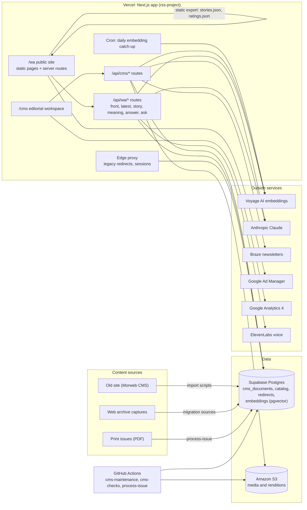

# Whisky Advocate platform: architecture and operations

This folder documents the whole system: the editorial CMS (`/cms`), the new Whisky Advocate website (`/wa`), how the old site's content was migrated, how content is cataloged and indexed, and how it all runs. Each page says what a part is, how it works, why it was built that way, and how to operate it. Diagrams are Mermaid, so GitHub renders them in place.

Keep these pages current: a change to a flow, a table, a job, a route or an environment variable updates the matching page and diagram in the same commit.

## The system at a glance

## Stack

| Layer | What | Why |
|---|---|---|
| App framework | Next.js 16 (App Router, route handlers, `src/proxy.ts`), React 19, TypeScript 5 | One app serves the CMS, the APIs and the site's server pages, deployed as one Vercel project. |
| Editor | Tiptap 3 with Yjs for live collaboration | Structured documents (`body_json`) alongside sanitized HTML, and several editors in one story at once. |
| Database | Supabase Postgres with pgvector; content writes go through SQL functions (`cms_save_document`, `cms_publish_document`, ...) that only the server-side service role may call | Rules (revisions, review gates, publishing checks) live next to the data, so no client can skip them. Browser roles are locked out. |
| Media | Amazon S3 with on-the-fly renditions (`/api/media`), `sharp` | Old site images were rehosted once; the site serves sized WebP/AVIF from one store. |
| Public site | Static HTML/CSS/JS in `public/wa`, data files exported from the CMS, plus server-rendered story, rating, recipe and producer pages | Static pages are fast and cheap at the edge; server pages give every story its own URL, head tags and structured data for search. |
| Search and recommendations | Voyage `voyage-3` embeddings in pgvector, Claude for answers and picks | Search by meaning across stories, ratings and images; recommendations an editor would choose. |
| Ads | Google Ad Manager (GPT), units under `/4054/whiskyadvocate.new/` | Its own unit tree, so nothing on the legacy site changes. |
| Email | Braze (sends and signups) | The newsletters already run there. |
| Tests | Vitest, with PGlite running every migration for the database tests | The SQL rules are tested against a real Postgres in CI. |
| Jobs | Vercel cron, GitHub Actions workflows | Long maintenance jobs run in Actions, one at a time. |

## Pages

| Page | Covers |
|---|---|
| [cms.md](cms.md) | The editorial workspace: library, editor, images, review, schedule, front page, newsletters, the assistant, roles, saving, revisions, and publishing. |
| [data-model.md](data-model.md) | Every table, function, trigger and grant, with an ER diagram and the list of migrations. |
| [migration.md](migration.md) | How the old site's content, images and URLs came across, and how the static export is built. |
| [catalog-and-media.md](catalog-and-media.md) | Ratings and the bottle catalog, tags, SEO passes, image naming and description, flavor profiles. |
| [website.md](website.md) | The public site: pages, data files, server routes, the `/api/wa` endpoints, caching, rate limits. |
| [indexing-and-search.md](indexing-and-search.md) | Embeddings, CMS search, search by meaning, recommendations, sitemaps, feeds, Google News. |
| [ads.md](ads.md) | Ad Manager tags, units, key-values, list interstitials, and the house ads project. |
| [seo-and-cutover.md](seo-and-cutover.md) | Redirects, canonicals, the Search Console audit, and the checklist for moving whiskyadvocate.com. |
| [operations.md](operations.md) | Hosting, environment variables, crons and workflows, migrations, tests, and the deploy flow. |

Older, narrower documents stay where they are and are linked from these pages: [cms-development.md](../cms-development.md), [content-architecture.md](../content-architecture.md), [editorial-workspace.md](../editorial-workspace.md), [migration-import.md](../migration-import.md), [migration-sources-api.md](../migration-sources-api.md), [platform-blueprint.md](../platform-blueprint.md), [wa-ad-map.md](../wa-ad-map.md), [wa-reader-validation.md](../wa-reader-validation.md).

## Repository map

| Path | What lives there |
|---|---|
| `src/app/cms`, `src/components/editorial` | The CMS pages and components. |
| `src/app/api/cms` | CMS APIs (documents, publish, media, search, assist, front, migration, analytics). |
| `src/app/api/wa`, `src/app/wa` | The site's APIs and server-rendered pages, sitemaps and feeds. |
| `src/lib/cms`, `src/lib/editorial`, `src/lib/wa` | Server logic: access, database calls, redirects, front page, embeddings, SEO, live stories. |
| `src/proxy.ts` | The edge proxy: legacy redirects and CMS sessions. |
| `public/wa` | The static site: HTML pages, `site.js`, `site.css`, `ads.js`, data files, house ads. |
| `supabase/migrations` | The database schema and functions, applied in file order. |
| `scripts` | Import, export, maintenance and enrichment scripts (run locally or by `cms-maintenance.yml`). |
| `.github/workflows` | `cms-checks.yml` (tests), `cms-maintenance.yml` (maintenance tasks), `process-issue.yml` (print intake). |
| `docs` | This documentation. |

## Decisions and why

- **One Next.js app for CMS, APIs and site server pages.** One deploy, one set of environment variables, shared server code (for example the same sponsorship rule labels stories and sets ad key-values).
- **Business rules in Postgres functions.** Revisions, review gates, slug rules and publishing checks run inside `cms_save_document`, `cms_publish_document` and friends. Routes stay thin, the rules hold no matter which client calls, and the PGlite tests prove them.
- **Ordinary saves cannot publish.** Publishing is its own checked step (`cms_publish_document`), so a stray state change cannot put a story on the site.
- **Static site plus live data.** The bulk of the site is static files exported from the CMS (fast, cacheable, works without the database); what changes often comes live: the home rotator (`/api/wa/front`), stories published since the export (`/api/wa/latest`), story pages (`/wa/<slug>`).
- **Everything migrated keeps its old URL reachable.** Each imported document carries a redirect from its old path; slug changes leave redirects behind; retired pages answer 410 rather than 404.
- **Separate ad unit tree for the new site.** Testing the new site never disturbs delivery or reporting on the legacy site.
- **The development host is not indexed.** It sends `noindex`, so it never competes with whiskyadvocate.com in search.
- **Two agents share the repo.** Claude Code and Cursor both commit to `main`; the rules in `AGENTS.md` (build on main's version, append CSS in commented blocks, small commits, never two maintenance jobs at once) keep them from overwriting each other.
