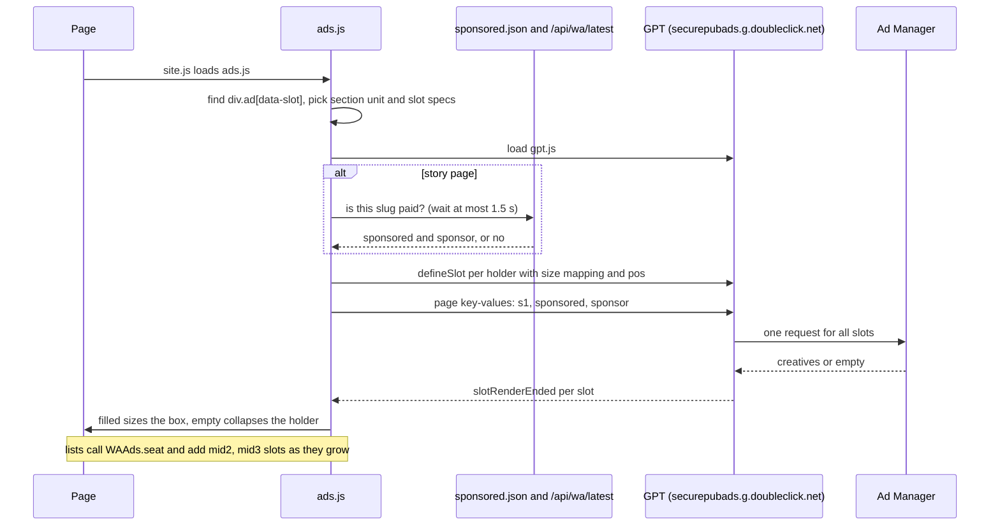

# Ads

The new site shows Google Ad Manager (GAM) display ads through Google Publisher Tags. All of it lives in one script, `public/wa/ads.js`, which `site.js` loads on every page. Where slots sit on each page, and the design rules for them, is in [../wa-ad-map.md](../wa-ad-map.md).

## Ad units

Network `4054`. The new site has its own unit tree, separate from the legacy `/4054/whiskyadvocate` units, so testing the new site never changes delivery or reporting on whiskyadvocate.com.

| Section | Unit path | Pages |
|---|---|---|
| homepage | `/4054/whiskyadvocate.new/homepage` | `index.html`, `/wa/` |
| stories | `/4054/whiskyadvocate.new/stories` | `stories.html`, `story.html`, stories at `/wa/<slug>` |
| ratings | `/4054/whiskyadvocate.new/ratings` | `finder.html`, `bottle.html`, `shelf.html`, `flavor-map.html`, ratings at `/wa/<slug>` (`body.rating-page`) |
| top20 | `/4054/whiskyadvocate.new/top20` | `top20.html` |
| cocktails | `/4054/whiskyadvocate.new/cocktails` | `cocktails.html`, `cocktail.html`, `/wa/recipes/<slug>` |
| guides | `/4054/whiskyadvocate.new/guides` | `guides.html` |
| travel | `/4054/whiskyadvocate.new/travel` | `travel.html` |
| video | `/4054/whiskyadvocate.new/video` | `video.html` |
| producers | `/4054/whiskyadvocate.new/producers` | `producers.html`, `producer.html`, `/wa/producers/<name>`, `retailers.html`, `retailer-club.html`, `industry.html` |
| club | `/4054/whiskyadvocate.new/club` | `ninety.html`, `club.html` |
| general | `/4054/whiskyadvocate.new/general` | every other page (about, contact, privacy, newsletter, app, tools, globe, new pages) |

The parent unit is "WA New Site" (`/4054/whiskyadvocate.new`, id 23389499996). Every unit accepts 970x250, 970x90, 728x90, 468x60, 320x50, 300x250 and 300x600. In the browser console, `WAAds.adUnit` shows the unit a page calls.

How the section is chosen: the page's file name through the `SECTIONS` map; for clean URLs, the path pattern (`/wa/recipes/...`, `/wa/producers/...`, else a story, or a rating when the page body has `rating-page`); otherwise `general`.

## Slots

`ads.js` finds every `div.ad[data-slot]` in the page and turns it into a GPT slot. The holder's class picks the slot:

| Holder class | Slot div id | `pos` | Size mapping | Sizes |
|---|---|---|---|---|
| `ad-above` | `div-id-for-above` | `top` | top | 970x250, 970x90, 728x90, 468x60, 320x50 |
| `ad-billboard` (not above) | `div-id-for-top` | `top` | top | same |
| `ad-leader` | `div-id-for-midleaderboard1` | `mid1` | leader | 970x90, 728x90, 468x60, 320x50 |
| `ad-leader` whose hint names 300 | `div-id-for-midleaderboard1` | `mid1` | leaderRect | adds 300x250 on phones (story and bottle pages) |
| `ad-mrec` | `div-id-for-midrectangle1` | `mid1` | rail | 300x600, 300x250 |

Each slot id is defined once per page. The size mappings by viewport width:

| Mapping | 1024 px and up | 768 px and up | 330 px and up |
|---|---|---|---|
| top | 970x250, 970x90 | 728x90, 468x60 | 320x50 |
| leader | 970x90 | 728x90, 468x60 | 320x50 |
| leaderRect | 970x90 | 728x90, 468x60 | 300x250 |
| rail | 300x600, 300x250 | 300x250 | 300x250 |

### List interstitials

Long lists (stories, cocktails, producers, guides, travel, video) call `WAAds.seat(container, every, name)` after they render. A leaderboard is placed after every `every` items that have more items below them, so each "More" reveals another one. Each gets its own slot, `div-id-for-midleaderboard2`, `3`, and so on, with `pos` `mid2`, `mid3`. In a grid, the cadence is rounded up to whole rows (a five-column grid gets one every 15 cards), and a resize that changes the column count seats them again. A list that re-renders refreshes its existing slots instead of defining new ones.

## Key-values

Set at page level before the first request:

- `pos`: per slot, as above.
- `s1=homepage` on the home page.
- `sponsored=yes|no` on every page, and `sponsor=<advertiser>` (lowercase, hyphenated) when known. Ad operations use these to keep competing brands off paid content.
  - The 90+ Club pages are always `sponsored=yes`, `sponsor=pernod-ricard-usa`.
  - A story (`story.html#slug` or `/wa/<slug>`) is sponsored when its slug is in `sponsored.json` (the export's list) or in the `sponsored` list of `/api/wa/latest` (paid stories published from the CMS since the export). Both are read from the script's own URL.
  - Ads wait at most 1.5 seconds for that answer, so the first request carries it.
- `test` is set empty.

`enableSingleRequest` sends all slots in one request; `collapseEmptyDivs` collapses empty ones.

## Empty slots collapse

When Ad Manager returns nothing for a slot, the holder gets `ad-empty` and collapses (CSS hides it). When it fills, the holder gets `ad-filled` and the box is sized to the creative.

There is no on-site house-ad fallback. An earlier version swapped in the HTML5 house ads when a slot was empty or answered by an old house order; it was removed on 2026-11-03 because those impressions never reached Ad Manager and it hid real delivery problems. Every impression shown is one Ad Manager served and counted.

## An ad request

## House ads

The new house ads (Whisky Advocate and sister-brand promotions) are trafficked in Ad Manager like any other creative, on the new units, in their own order. The creatives are built in the repo:

- `scripts/house-ads/`: `assets.json` and `runway.mjs` (Runway stills and five-second loops, needs `RUNWAYML_API_SECRET`), `source/` (the Runway output kept in the repo, plus the magazine cover, the Glencairn reference photo and the Cigar Aficionado logo), `build.mjs` (writes the HTML5 bundles with `clickTag`, the loop, a poster, subset fonts, and a manifest), `backups.cjs` (static end-frame JPGs). See `scripts/house-ads/README.md`.
- `scripts/house-ads/trafficking.md`: every current house creative with its id and click-through, what replaces it, the new click-throughs, zip names, hosted URLs and tag templates.
- `/wa/house-ads/` (the gallery, `public/wa/house-ads/index.html`): every ad playing, the running ads beside their replacements, and zip and JPG downloads built in the browser.

Each bundle is under 950 KB and a few files (Ad Manager allows 1 MB and 50). The film loads after the page, plays muted, pauses off screen, and all motion stops by 30 seconds. The bundles also accept the click URL as a `clickTag` query parameter, so they can be trafficked as hosted iframe tags with `%%CLICK_URL_ESC%%`.

## Changing ads

- New page: add it to `SECTIONS` in `ads.js` (or it uses `general`) and place `div.ad[data-slot]` holders following [../wa-ad-map.md](../wa-ad-map.md).
- New slot type: add a class and spec in the `slots` map, and a size mapping if needed. Keep slot ids unique per page.
- House ad copy or links: edit the `campaigns` table in `scripts/house-ads/build.mjs`, run `node scripts/house-ads/build.mjs` and `node scripts/house-ads/backups.cjs` (with `public/` served on port 8765), and update `trafficking.md`.

## Watch out for

- The sponsored lookup only runs on story pages. A paid page of another kind needs its own rule in `pageContext`.
- A new list page that renders more items must call `WAAds.seat`, or it gets no interstitials.
- Ad units, line items and creatives are managed in Ad Manager, not in this repo. A unit change there needs the matching path change here.
