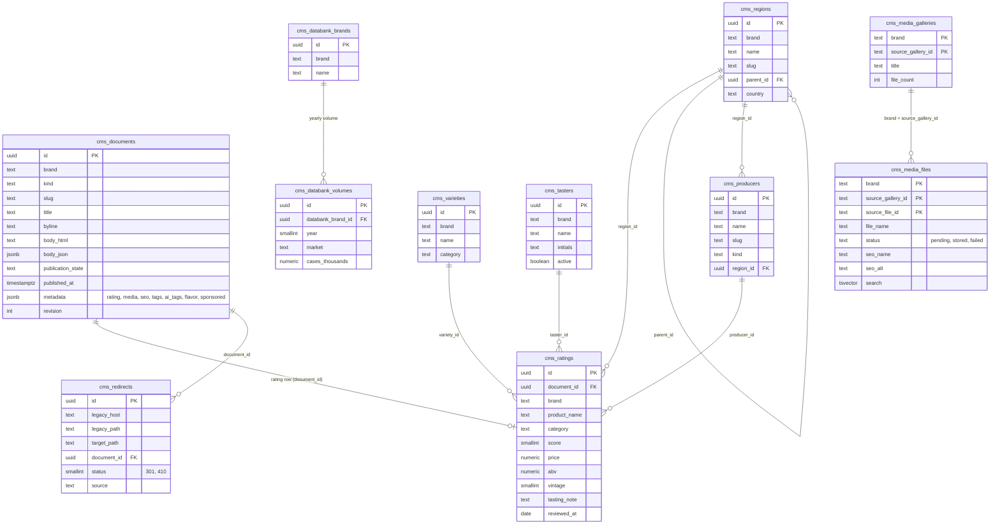
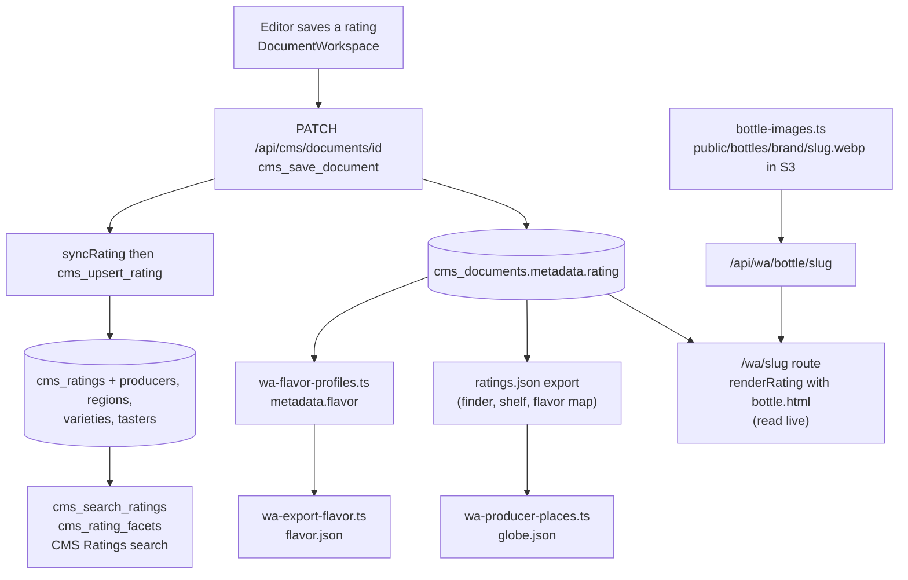

# Cataloging: ratings, tags, descriptions and media

This page covers how the CMS organizes what it holds once it is imported: the relational ratings catalog, tags, search
and answer-engine descriptions, the names and descriptions of pictures, bottle photographs, captions, flavor profiles,
producer places, video posters and the 90+ Club data. Each section says what it is, how it works, why, and how to run it
again. How the content arrived is in [migration.md](migration.md).

Most passes here are run from GitHub Actions as **CMS maintenance** (`.github/workflows/cms-maintenance.yml`), dry run
unless `apply` is ticked. **Never run two maintenance jobs at once**: four at once exhausted the database's connection
pool and took the site down.

## The data model

Column lists are abridged; the full definitions are in `supabase/migrations/20261101100000_cms_catalog.sql`,
`20261101210000_cms_media_galleries.sql`, `20261101220000_cms_media_names.sql` and
`20261101110000_cms_blocks_redirects_delivery.sql`.

## Ratings and the relational catalog

**What it is.** Every rating is a CMS document (`kind = 'rating'`) whose working copy lives in `metadata.rating` (score,
price, ABV, producer, category, reviewer, note). Beside it, the "Shanken schema" keeps the same facts in strict tables:
`cms_ratings` joined to `cms_producers`, `cms_regions` (country, region, appellation, nested by `parent_id`),
`cms_varieties` (grains and styles for spirits, grapes for wine, wrappers for cigars) and `cms_tasters`. The Impact
Databank's brands and yearly volumes in thousands of 9-liter cases (`cms_databank_brands`, `cms_databank_volumes`) sit in the same migration.

**How it works.**

- `cms_upsert_rating(document_id, rating, actor)` keeps the relational row in step with `metadata.rating`. Names are
  resolved to catalog rows, created when new, so the joins stay strict.
- The document save route (`src/app/api/cms/documents/[id]/route.ts`) calls `syncRating` (`src/lib/cms/catalog-server.ts`)
  after any save that touches the rating, title or excerpt of a `rating` or `product_review`.
- `cms_catalog_lookup` serves the editor's typeahead (producers, regions, varieties, tasters) through `/api/cms/catalog`.
- `cms_search_ratings` is faceted search over score, price, vintage, region, variety, producer and taster at once, with a
  total for paging; `cms_rating_facets` returns the counts for the filters. Both serve `/api/cms/ratings` and the CMS's
  Ratings search page.
- Row level security is tied to the user's JWT (`cms_jwt_brands()` reads `app_metadata.cms_role` and `cms_brands`), so a
  user-scoped client only sees its own publications. Ratings and documents are written only through service-role
  functions, so revision history cannot be skipped.

**Why.** JSON is easy to edit but poor to query. The editor works on one document; search, cross-references ("more from
this distillery") and facet counts read strict tables with indexes on score, price, vintage, producer, region, variety
and taster.

**How a rating reaches the website.**

**The site's copy.** The rating's own page (`/wa/<slug>`) is rendered from the database on each request. The finder,
shelf and other tools read `public/wa/ratings.json`, a compact column table (8,225 rows on 2026-11-03) with the columns
`slug, n` (name), `c` (category), `s` (score), `p` (price), `a` (ABV), `pr` (producer), `by` (reviewer), `issue`, `d`
(date), `sm, sw, ri, li` (smoky, sweet, rich and light character scores), `img` and `w`. No export script for this file
is checked in yet; regenerate it from the current CMS rather than restoring an old copy (rule in `AGENTS.md`).

## Tags

**AI tags.** `scripts/tag-stories.ts` gives every published article a consistent tag set (style, region, producer, bottle,
theme), a one-line summary and the phrases a reader would search, written into `metadata.ai_tags`, `ai_summary` and
`ai_search`. The site's tag pages, search and "more like this" read them, and the export puts them first in each story's
tags. Needs `ANTHROPIC_API_KEY`. Run: `cms-maintenance.yml` task `tags` (`--force` redoes tagged stories).

**Legacy tag cleanup.** `scripts/wa-clean-tags.ts` removes noise the Morweb export left in `metadata.tags`: staff
usernames (found from bylines, first initial plus surname, plus a short list for multi-word surnames), the `trending`
flag and the site's own name. Lowercase topics are capitalised and tags that differ only in case merge. The AI tags are
not touched. Each change is saved through `cms_save_document`, so the history keeps the old list. On 2026-11-03 it
cleaned 3,401 documents. Run locally: `node --import tsx scripts/wa-clean-tags.ts --brand wa`, then with
`--apply --development-target <host>`, then regenerate the story export.

## Search and answer-engine descriptions

**The SEO and GEO pass.** `scripts/wa-seo-pass.ts` writes `metadata.seo` for every published record, the fields
`src/lib/wa/seo.ts` renders into each page's head:

- `title` (25 to 60 characters, main subject first) and `description` (120 to 155 characters, facts from the piece);
- `og_title` and `og_description` for social sharing;
- `focus_keyword` and 5 to 10 `keywords`;
- `summary` (answer-first, up to 320 characters, for AI answer engines), `key_facts` (3 to 5 citable facts) and
  `entities` (people, brands, distilleries, places, products);
- `pass` (version, model, time) and `previous` (the title and description it replaced).

An editor's own title and description are kept when they already meet the rules, and `metadata.seo.locked = true`
leaves a record alone. Run: `cms-maintenance.yml` tasks `seo-preview` (8 articles, no writes), `seo`, and `seo-fix`
(repairs). `WA_SEO_MODEL` picks the model.

**Missing descriptions.** `scripts/fill-meta-descriptions.ts` fills `metadata.seo.description` where there is none, in
this order: the old site's own meta or og description (from the source snapshot), the excerpt, a description built from
the record's fields (ratings, glossary terms, clubs), the AI summary, and only then a new one from the model.

**Why the dek is kept apart.** The SEO pass rewrites descriptions for search. The site's visible dek uses the editors'
line from before the pass (`seo.previous.description`) when the pass replaced it, so readers see the editor's words.

## Image naming

**What it is.** `scripts/wa-media-name.ts` gives every file in the gallery library a web name: an SEO file name, a title,
alt text, a short description and keywords (columns `seo_name`, `seo_title`, `seo_alt`, `seo_description`, `keywords` on
`cms_media_files`, migration `20261101220000_cms_media_names.sql`).

**How it works.** Claude looks at the picture (resized to 768 px) with the clues the old site left: the Morweb file name,
its gallery, its alt text and the titles of stories that use it. Files that are not pictures are named from the clues
alone. File names are lowercase hyphenated words, 3 to 8 words, at most 60 characters, the most specific identifier first;
zero-padded numbers after series words (for example an edition number) are kept. A file kept in several galleries is
named once. A search vector over the names feeds `cms_search_media`, which serves the CMS Media page, CMS search and the
editor's image picker. The site serves a picture under its name at `/api/wa/asset/<web-name>-<sha256>.jpg`.

**Run it.** `cms-maintenance.yml` tasks `names-preview` (12 files, no writes), `names`, `names-retry` (failed ones),
`names-dedupe-preview` and `names-dedupe`. `MEDIA_NAME_MODEL` picks the model.

## Image descriptions

`scripts/describe-media.ts` writes a `vision` object onto each media item of a document: what is in the picture, its
style, mood, colors and subjects, from a short-lived signed URL of the stored original. Lead photographs go first and the
newest stories first. The CMS's asset search ("find a moody bar shot") and the embedding index read it. Run:
`cms-maintenance.yml` task `describe`. Needs `ANTHROPIC_API_KEY` and the AWS variables.

## Bottle photographs

**Standard bottle shots.** `scripts/bottle-images.ts` fetches each rating's legacy photograph, lifts a flat background
to transparency (a flood fill from the edges, so a bottle on white, grey or any flat colour comes out clean, and a bottle
in a scene is left alone), trims it and sets it in the same 3:4 frame at 480 by 640 as WebP under
`public/bottles/<slug>.webp` in the media bucket, with a manifest. `/api/wa/bottle/<slug>` redirects to a signed link for
it, or answers 404 so the page hides the picture. Run: `cms-maintenance.yml` task `bottles` (its apply needs no
development target, because it writes only to S3).

**Clearing mats.** `scripts/clear-backgrounds.ts` walks the framed bottles again and removes the white or grey mat a
first pass left inside the frame, and clears product shots in posts and the Top 20 (the `_300` thumbnails, files named
bottle-shot, Top 20 bottle renders), pointing pages at `/api/wa/cleared/<id>`. Bars, cocktails and landscapes stay as
photographed. Run locally with `--apply`; it needs the AWS variables.

**Why.** Thousands of photographs taken over years on different backgrounds now sit on the site's cream page in one
consistent frame.

## Captions and credits

`scripts/restore-captions.ts` with `src/lib/cms/captions.ts` brings back captions and photo credits the old site stored
in three places: the lead caption in a Morweb custom field (`custom_thumb_text`), WordPress-era captions inside attachment
wrappers, and Morweb-era captions in alt text with the photographer appended in capitals. Bodies gain `<figure>` and
`<figcaption>` blocks, media items gain `caption` and `credit`, and the lead is kept in `metadata.lead_image`. Run:
`cms-maintenance.yml` task `captions`.

## Flavor profiles

- `scripts/wa-flavor-profiles.ts` reads each published rating's tasting note with a model and stores `metadata.flavor`:
  twelve flavor axes scored 0 to 10, body and finish 1 to 5, the main flavors as plain words and one line in the house
  voice. It is resumable: ratings that already have the current version are skipped. Needs `ANTHROPIC_API_KEY`;
  `WA_FLAVOR_MODEL` picks the model. Run locally with `--apply --development-target <host> [--concurrency 8]`.
- `scripts/wa-export-flavor.ts` writes `public/wa/flavor.json`: each profile in compact form with a 2D position from a
  seeded UMAP, so bottles that taste alike sit together and the layout is stable between runs. The flavor map, "bottles
  like this" and the palate profile read it.

## Producer places (the distillery globe)

`scripts/wa-producer-places.ts` writes `public/wa/globe.json`: where each producer with three or more ratings makes its
whisky (the distillery, or the home of a blender or bottler), placed by a model from the producer's name and bottles and
kept only when it is sure, plus a dotted landmass (Natural Earth 110m) for the continents. It reads `ratings.json` and is
resumable. Needs `ANTHROPIC_API_KEY`.

## Video posters

`scripts/wa-video-posters.py` gives the video channel sharper posters: YouTube `maxresdefault` (1280 by 720), else
`sddefault`, else `hqdefault`; JW Player posters at width 1280. Rerun after videos are added:
`python3 -I scripts/wa-video-posters.py public/wa`.

## The 90+ Club page

`scripts/wa-ninety.py` reads whiskyadvocate.com/90plus into `public/wa/ninety.json`. The live page is the source of truth
for the paid partner program: the featured film, the member bottles (score, category, price, picture), the club's stories
and the Top-Shelf Spirits. Members are matched to the site's ratings so "Learn More" opens the bottle's page, and stories
to the story index. Run: `python3 -I scripts/wa-ninety.py public/wa`. Every 90+ Club page carries the ad key-values
`sponsored=yes` and `sponsor=pernod-ricard-usa`.

## Watch-outs

- One maintenance job at a time.
- Model passes cost money per record: run the `-preview` task first and read its output.
- The static data files (`stories.json`, `ratings.json`, `flavor.json`, `globe.json`, `ninety.json`) are generated. After
  a pass that changes what they show, regenerate them from the current CMS and commit; do not hand-edit them or restore
  older copies.
