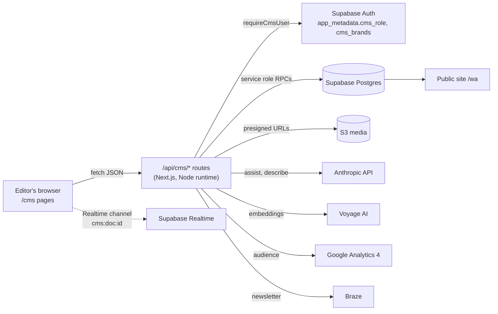
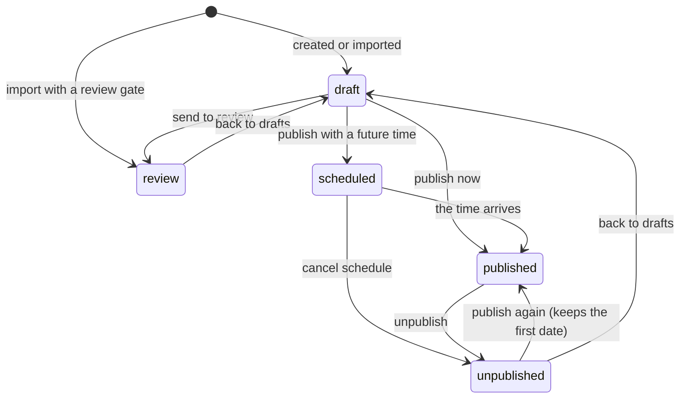
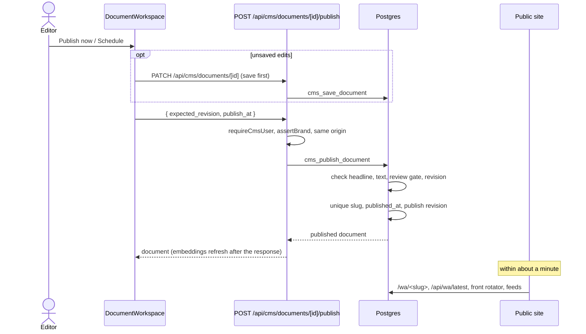

# The editorial CMS (`/cms`)

The CMS is where editors write, review, schedule and publish stories, ratings and pages for the four M. Shanken publications (Whisky Advocate `wa`, Wine Spectator `ws`, Cigar Aficionado `ca`, Market Watch `mw`). Whisky Advocate is the first publication on it. It runs inside the same Next.js app as the public site and reads and writes the Supabase database described in [data-model.md](data-model.md).

Related reading, not repeated here:

- [../editorial-workspace.md](../editorial-workspace.md): the design language, layout and page-by-page tour of the workspace.
- [../cms-development.md](../cms-development.md): local setup, the Morweb import and the print-intake trial.
- [operations.md](operations.md): hosting, jobs, environment variables and deploys.

## What it is made of

| Layer | Where | What it does |
|---|---|---|
| Pages | `src/app/cms/*/page.tsx` | One route per workspace page: home desk, library, document, review, schedule, front, media, search, audience, print, migration, demo. |
| Workspace UI | `src/components/editorial/` | React components for every page, the shell and the editor. Styles are scoped under `.ed` in `editorial.css`. |
| Data layer | `src/lib/editorial/data.ts` | One `EditorialData` interface with two providers: live (calls `/api/cms/*`) and demo (a seeded in-browser store). |
| API | `src/app/api/cms/**/route.ts` | Server routes. Every one checks the session and the publication before touching data. |
| Server helpers | `src/lib/cms/*`, `src/lib/editorial/server/*` | Database access, validation, redirects, front page, embeddings, the AI assistant, GA4. |
| Database | Supabase Postgres | Documents, revisions, catalog, redirects, embeddings. Changes go through SQL functions (RPCs). |

## The workspace

The shell (`Shell.tsx`, `WorkspaceLayout.tsx`, `Sidebar.tsx`, `TopBar.tsx`) wraps every `/cms` page. It holds the publication switcher, the theme, the dirty-state guard and the `⌘K` command palette (`CommandPalette.tsx`: jump to a page, switch publication, create a document, open one by title). `CmsRoot.tsx` chooses the connected workspace or the demo; `AccessScreen.tsx` explains why the connected one cannot open (not set up, access denied, unavailable).

| Page | Component | Purpose |
|---|---|---|
| `/cms` | `HomeDesk.tsx` | The day at a glance: a one-line brief, the workflow pipeline, the next things to do, a seven-day runway and the latest edits. |
| `/cms/library` | `Library.tsx` | All content with filters, saved views, bulk state changes and keyboard navigation. |
| `/cms/doc/[id]` | `DocumentWorkspace.tsx` | The editor (see below). |
| `/cms/review` | `ReviewQueue.tsx` | Documents in review and imports held by a review gate. |
| `/cms/schedule` | `Schedule.tsx` | A calendar of published and planned stories. |
| `/cms/front` | `FrontPage.tsx` | The five positions of the public home page's news rotator, with pins. |
| `/cms/media` | `MediaLibrary.tsx` | The Morweb gallery library with S3 copies, web names and the stories that use each file. |
| `/cms/search` | `SearchPage.tsx`, `RatingsSearch.tsx` | One search over documents, images, the gallery library and keywords, plus faceted ratings search. |
| `/cms/audience` | `Audience.tsx` | GA4 scorecards per publication. |
| `/cms/print` | `PrintIntake.tsx`, `UploadIssue.tsx`, `IssueStatus.tsx` | Upload a print PDF; the worker extracts stories as review candidates. |
| `/cms/migration` | `MigrationView.tsx` | The migration inventory: what was captured from the old sites and what still needs review. |
| `/cms/demo` | `DemoRedirect.tsx` | Opens the whole workspace on demo data, with no sign-in. |

### The document editor

`DocumentWorkspace.tsx` is one page with a writing column and a properties rail.

- **Body:** `BodyEditor.tsx` is a TipTap editor. It saves both `body_html` (the rendered truth every reader uses) and `body_json` (the block structure). Blocks can be marked premium for the paywall.
- **Images:** attached media with captions, credits, alt text and the lead image. `ImageCropper.tsx` stores crop geometry and a focal point per aspect preset, never cut pixels. Pictures from the gallery library can be inserted.
- **Preview:** `PreviewMatrix.tsx` renders the draft at desktop, tablet, mobile and email widths in sandboxed frames.
- **History and sources:** every save is a revision; the History tab diffs and restores. Sources shows newer captures of an imported story without overwriting the edit.
- **Rail:** Publishing (below), Story (section, summary, slug), Search and sharing (SEO title and description), the rating panel with catalog typeahead (`CatalogField.tsx`), `SiteCard.tsx` (what the site makes of the story: AI tags, rotator position, a pin control) and `NewsletterCard.tsx`.
- **Assistant:** `Assistant.tsx` opens beside the editor (see below).
- **Drafts in the browser:** unsaved changes are kept in local storage so a crash or a closed tab can be restored.

## The data layer

`src/lib/editorial/data.ts` defines `EditorialData`: list, get, save, publish, unpublish, create, history, media, the media library, search, analytics and more. Two providers implement it:

- **Live** calls `/api/cms/*` with JSON, raises `DataError` with the server's code (`revision_conflict`, `validation_failed`, `setup_required`) and emits a change event after every mutation so open views refresh.
- **Demo** keeps a seeded store in the browser (`demo-data.ts`) and mirrors the server's rules (revision checks, required title, the publish checks), so the demo behaves like the real thing.

Why: every page can be built and tested without a database, the demo works on any preview, and the UI has one contract to code against.

## Sign-in, roles and publications

- Editors sign in with Supabase Auth. The session lives in an httpOnly cookie that `src/proxy.ts` refreshes on every `/cms` and `/api/cms` request.
- `requireCmsUser()` (`src/lib/cms/auth-server.ts`) asks Supabase for the verified user on every request; it never trusts the cookie's payload.
- `cmsPermissions()` (`src/lib/cms/access.ts`) reads only `app_metadata`, which only an administrator can change:
  - `cms_role`: `admin` (every publication) or `editor` (only the publications listed in `cms_brands`). Anything else is refused.
  - `cms_brands`: the publications an editor may work on.
- Every route then checks the document's or request's publication (`assertBrand`). Writes also require a same-origin request (`assertSameOrigin`).
- In the database, browser roles cannot call the write functions at all; the server uses the service role. Row Level Security policies based on the same JWT claims (`cms_jwt_brands()`) let a user-scoped client read only its own publications' rows.
- On a Vercel preview, the connected CMS is off unless `CMS_ENABLE_CONNECTED_PREVIEW=true` (`src/lib/cms/runtime-config.ts`), so a preview can never write to production by accident.

## The API routes

| Route | Methods | What it does |
|---|---|---|
| `/api/cms/session` | GET | The signed-in user, role and publications. |
| `/api/cms/overview` | GET | Counts for the home desk. |
| `/api/cms/documents` | GET, POST | List with filters and paging; create a manual document. |
| `/api/cms/documents/[id]` | GET, PATCH | Read one; save changes through `cms_save_document`. A slug change leaves a redirect; ratings sync to `cms_ratings`; embeddings refresh after the response. |
| `/api/cms/documents/[id]/publish` | POST, DELETE | Publish now or at a time; unpublish (see Publishing). |
| `/api/cms/documents/[id]/history` | GET | Revisions and source snapshots. |
| `/api/cms/documents/[id]/media` | GET | Presigned URLs for the document's images. |
| `/api/cms/documents/[id]/migration-sources` | GET | The captured archive records behind an imported story. |
| `/api/cms/documents/[id]/collab` | GET, PUT | The durable Yjs state; merge an update into it. |
| `/api/cms/documents/[id]/newsletter` | GET, POST | Send history; render and dispatch a newsletter through Braze. |
| `/api/cms/realtime` | GET | What the browser needs to join a document's Realtime channel. |
| `/api/cms/search` | GET | Unified search: documents, attached images, gallery files, keywords, and meaning when embeddings are on. |
| `/api/cms/ratings` | GET | Faceted ratings search. |
| `/api/cms/catalog` | GET | Typeahead over producers, regions, varieties, tasters. |
| `/api/cms/front` | GET, PUT | The five front positions; pin or clear one. |
| `/api/cms/redirects` | GET, POST | The legacy URL map, or an export for Vercel, nginx, CloudFront or JSON; add one by hand. |
| `/api/cms/media/library`, `/files`, `/file` | GET | The gallery library, its files and one file. |
| `/api/cms/migration/inventory` | GET | Counts of captured archive records by kind. |
| `/api/cms/assist` | POST | The AI assistant. |
| `/api/cms/analytics` (+ `connect`, `callback`, `connection`) | GET (`connection` also POST, DELETE) | GA4 scorecards and page performance; connect, choose a property or disconnect a Google account. |

## Saving and revisions

- `PATCH /api/cms/documents/[id]` sends the fields that changed and the revision the editor opened (`expected_revision`).
- `cms_save_document` locks the row, refuses a stale revision with `revision_conflict`, merges `metadata` at the top level (so an SEO edit never erases migration or media data), bumps `revision`, and appends a full snapshot to `cms_document_revisions` with the actor.
- On a conflict the editor keeps the typed text, loads the newer version, and asks the editor to review it in History before saving again.
- Why optimistic revisions: two editors can never silently overwrite each other, and no locks are held while someone types.
- Watch out: `cms_save_document` deliberately refuses a change to `published`. Publishing has its own checked step.

## Review gates

Imports that need a human look carry `metadata.review = { required: true, reasons: [...] }` (for example a web-archive capture, or a print extraction with uncertain article boundaries).

- The trigger `cms_guard_retained_document` forces such documents into `review` on insert, refuses to publish them, and refuses any ordinary save that changes the gate.
- Only `cms_resolve_review` can clear a gate. It records an append-only row in `cms_review_resolutions` (actor, cleared reasons, note) and may move the document on in the same step. No workspace button calls it yet; it is run by an administrator against the database.
- The editor shows the reasons and blocks the Publish button while a gate is set.

## Publishing (added 2026-11-03)

Publishing is one checked step, separate from saving.

Status on 2026-11-03: the code is live, but its two migrations (`20261103160000_cms_publishing.sql` and `20261103161000_cms_redirect_host_www.sql`) still have to be applied to the production database, which needs the owner's approval. Until then, Publish answers "setup required" and everything else works as before.

- **Database:** `cms_publish_document(id, expected_revision, publish_at, actor)` and `cms_unpublish_document(id, expected_revision, actor)` in `supabase/migrations/20261103160000_cms_publishing.sql`.
  - Requires a headline and story text; refuses review-gated documents and stale revisions.
  - Fills the slug from the headline when empty (`cms_slugify`) and keeps it unique within the publication, also against old addresses that already redirect to another story.
  - Sets `published_at` to the given time (a future time schedules the story), else the story's first publish time, else the old site's date for an imported story, else now. So taking a story down and putting it back does not make it new.
  - Records a `publish` or `unpublish` revision. Unpublishing stores `metadata.unpublished_at`.
- **API:** `POST /api/cms/documents/[id]/publish` with `{ expected_revision, publish_at? }` (at most a year ahead); `DELETE` with `{ expected_revision }` takes it down. The database's own messages ("Before publishing, add the story text") are passed to the editor.
- **Editor:** the Publishing panel shows a checklist (headline and text required; byline, section, summary and lead image recommended), then Publish now, Schedule for the planned time, Publish now instead, or Unpublish / Cancel schedule. Unsaved edits are saved first. A published story shows its address; saved edits to it go live within a few minutes.
- **Scheduled stories stay hidden** until their time in every public read: `cms_public_documents`, `/wa/<slug>`, `/api/wa/story`, the delivery API, the home rotator, the sitemaps and feeds, and `/api/wa/latest`.

"Scheduled" is not a separate database state: it is `publication_state = 'published'` with `published_at` in the future, which every public read treats as not out yet.

## Real-time collaboration

Several editors can work on one story at once.

- `useCollaboration.ts` loads the durable Yjs state (`GET .../collab`), joins a private Supabase Realtime channel `cms:doc:<id>` and exposes presence (names and colors).
- `SupabaseProvider.ts` carries Yjs updates and awareness (cursors) as broadcast messages; a newcomer asks for the full state and the first peer answers.
- The durable copy lives in `cms_collab_documents`; `PUT .../collab` merges updates on the server. Yjs updates are commutative and idempotent, so a late or disconnected editor can only add what it knows.
- Realtime policies (`20261101130000_cms_collab_channels.sql`) let a user read or send on a channel only when the document is in one of their publications.
- Without a Realtime grant (demo, or Realtime not set up) collaboration reports `off` and the editor works as a single-user editor.
- Saving still goes through `cms_save_document`; collaboration shares the draft, not the saved revision.

## The AI assistant

`POST /api/cms/assist` (`src/lib/editorial/server/assist.ts`, model `claude-opus-5-5`, needs `ANTHROPIC_API_KEY` or `ANTHROPIC_AUTH_TOKEN`) offers three things:

- **SEO and GEO review:** reads the open story and suggests a title, SEO title, description, slug and other changes as apply actions the editor accepts one by one.
- **Chat about the story,** with search intent (it can look up related content).
- **Image descriptions** for search (`describeImage`), read from S3 through a presigned URL and saved to the image's `vision` metadata.

Why: suggestions are applied by the editor into the draft, so nothing changes without a person choosing it.

## Audience (GA4)

`/cms/audience` and the per-story performance strip read the GA4 Data API (`src/lib/editorial/server/ga4.ts`). Two ways to connect, checked in order:

1. A Google account connected from the Audience page (OAuth: `GOOGLE_CLIENT_ID`, `GOOGLE_CLIENT_SECRET`, `GOOGLE_REDIRECT_URI`, optional `GOOGLE_WORKSPACE_DOMAIN`), stored per publication in `cms_google_credentials` with the chosen property. That table is service-role only.
2. A service account in `GA4_SERVICE_ACCOUNT_JSON` with a property id per publication.

## The home page rotator (front pins)

The public home page's news rotator has five positions (`src/lib/cms/front-server.ts`, table `cms_front_slots`).

- A position with a row is pinned to a document (with a label: sponsored, from the archive, editors' pick) until it is cleared or its `ends_at` passes.
- Every other position shows the newest published story in order, skipping pinned ones. Imported stories are dated by the old site's date and CMS stories by `published_at`; both lists are read and merged by date.
- Editors manage it at `/cms/front`; `SiteCard.tsx` also offers a pin control on the document page.
- The site reads it from `/api/wa/front`, cached a minute.

## Newsletters (Braze bridge)

`NewsletterCard.tsx` marks a story as a newsletter send (for example a Daily Alert).

- `POST /api/cms/documents/[id]/newsletter` renders the email from the saved story (`src/lib/newsletter/render.ts`) and calls Braze's API-triggered campaign (`src/lib/newsletter/braze-server.ts`).
- Configuration: `BRAZE_REST_ENDPOINT`, `BRAZE_API_KEY`, and the campaign id from `BRAZE_CAMPAIGN_<BRAND>_<KIND>`, then `BRAZE_CAMPAIGN_<BRAND>`, then `BRAZE_CAMPAIGN_ID`.
- Every attempt is logged in `cms_newsletter_sends`. Without Braze configured the send is recorded as simulated, so the flow can be tested.
- Watch out: a story still in review is refused when its review gate is set; unsaved edits are flagged before sending.

## What to watch out for

- Never add a code path that sets `publication_state = 'published'` directly; use `cms_publish_document`.
- `metadata` merges at the top level only: send nested objects (`seo`, `rating`, `media`) complete.
- Production database changes (new migrations) need the owner's approval before they are applied; see [operations.md](operations.md).
- The demo provider must keep mirroring the server's rules, or the demo will accept things production refuses.
