# Data model

Everything lives in one Supabase Postgres database (project `itludqxofwurjwtbgkcl`). The schema is built only by the SQL files in `supabase/migrations/`, applied in file-name order. This page explains what each table holds, which functions change it, and how access is locked down.

## Principles

- **One table for all content.** Stories, ratings, pages, glossary entries, directory and collection entries, product reviews and retained legacy records are all rows of `cms_documents`, told apart by `kind`. Kind-specific data sits in `metadata` (JSON) and, for ratings, in strict relational tables.
- **Writes go through functions.** The app changes content by calling SQL functions (RPCs) such as `cms_save_document` and `cms_publish_document`. They check the input, take a row lock, bump `revision` and write history in one transaction.
- **History is append-only.** Revisions, source snapshots, migration sources and review resolutions can be inserted but never updated, deleted or truncated, not even by the service role.
- **The browser never writes.** Write functions are revoked from `PUBLIC`, `anon` and `authenticated` and granted to `service_role` only. The server routes call them after checking the user. A few read-only tables and functions are open to `authenticated` users, filtered by Row Level Security to the publications in their JWT.
- **Additive migrations.** Each migration adds; none rewrites existing editorial rows or history. Migrations that need an extension (pgvector, Realtime) skip themselves where it is missing, so the PGlite test database can run every file.

## The main tables

```mermaid
erDiagram
  issues ||--o{ articles : contains
  articles ||--o{ article_images : has
  issues ||--o{ cms_documents : "print intake"
  cms_documents ||--o{ cms_document_revisions : "every save"
  cms_documents ||--o{ cms_source_snapshots : "every capture"
  cms_documents ||--o| cms_ratings : "rating row"
  cms_documents ||--o{ cms_embeddings : "text and images"
  cms_documents ||--o{ cms_redirects : "old addresses"
  cms_documents ||--o{ cms_front_slots : "pinned in"
  cms_documents ||--o{ cms_newsletter_sends : "sent as"
  cms_documents ||--o| cms_collab_documents : "live draft"
  cms_documents ||--o{ cms_review_resolutions : "gate cleared"
  cms_producers ||--o{ cms_ratings : rates
  cms_regions ||--o{ cms_ratings : from
  cms_regions ||--o{ cms_producers : in
  cms_regions ||--o{ cms_regions : parent
  cms_varieties ||--o{ cms_ratings : of
  cms_tasters ||--o{ cms_ratings : by
  cms_databank_brands ||--o{ cms_databank_volumes : sells
  cms_media_galleries ||--o{ cms_media_files : holds

  cms_documents {
    uuid id PK
    text brand
    text kind
    text source_system
    text source_key
    text title
    text byline
    text body_html
    jsonb body_json
    text excerpt
    text slug
    text publication_state
    timestamptz published_at
    jsonb metadata
    int revision
    tsvector search_text
  }
  cms_document_revisions {
    uuid id PK
    uuid document_id FK
    int revision
    jsonb snapshot
    text actor
    text reason
  }
  cms_source_snapshots {
    uuid id PK
    uuid document_id FK
    text source_hash
    jsonb payload
  }
  cms_migration_sources {
    uuid id PK
    text brand
    text source_kind
    text source_key
    text payload_sha256
    jsonb payload
  }
  cms_ratings {
    uuid id PK
    uuid document_id FK
    uuid producer_id FK
    uuid region_id FK
    uuid variety_id FK
    uuid taster_id FK
    text product_name
    smallint score
    numeric price
    numeric abv
  }
  cms_redirects {
    uuid id PK
    text legacy_host
    text legacy_path
    text target_path
    uuid document_id FK
    smallint status
    bigint hit_count
  }
  cms_embeddings {
    uuid id PK
    uuid document_id FK
    text kind
    int media_index
    text content_hash
    vector embedding
  }
  cms_front_slots {
    uuid id PK
    text brand
    int position
    uuid document_id FK
    text label
    timestamptz ends_at
  }
  cms_newsletter_sends {
    uuid id PK
    uuid document_id FK
    text kind
    text status
    text campaign_id
  }
  cms_collab_documents {
    uuid document_id PK
    text state_base64
    int revision
  }
  cms_review_resolutions {
    uuid id PK
    uuid document_id FK
    jsonb previous_review
    text next_state
    text actor
  }
  cms_media_galleries {
    text brand PK
    text source_gallery_id PK
    text name
    int file_count
  }
  cms_media_files {
    text brand PK
    text source_gallery_id PK
    text source_file_id PK
    text sha256
    text s3_key
    text seo_name
    text status
  }
  issues {
    uuid id PK
    text brand
    text issue_id
    issue_status status
  }
  articles {
    uuid id PK
    uuid issue_uuid FK
    text title
    text html
  }
  article_images {
    uuid id PK
    uuid article_uuid FK
    text s3_key
  }
  cms_producers {
    uuid id PK
    text name
    uuid region_id FK
  }
  cms_regions {
    uuid id PK
    text name
    uuid parent_id FK
  }
  cms_varieties {
    uuid id PK
    text name
  }
  cms_tasters {
    uuid id PK
    text name
  }
  cms_databank_brands {
    uuid id PK
    text name
  }
  cms_databank_volumes {
    uuid id PK
    uuid databank_brand_id FK
    smallint year
    numeric cases_thousands
  }
```

Tables not drawn above, because they stand alone:

- `cms_google_credentials`: one GA4 connection per publication (tokens, property). Service role only; RLS is on with no policies.
- `wa_recommendations`: cache of the public site's AI bottle recommendations per story, cocktail, bottle or producer page.
- `wa_rate_limits`: shared rate-limit counters per bucket and time window for the public search routes; visitors appear only as a hash of their IP.

### `cms_documents`

The canonical record of every piece of content.

- **Identity:** `(brand, kind, source_system, source_key)` is unique, so re-importing the same source updates one row instead of creating a copy. `source_system` is `morweb`, `print`, `manual` or `web_archive`; `source_hash` is the digest of the captured source.
- **Brand and kind:** `brand` is `wa`, `ws`, `ca` or `mw`. `kind` is `article`, `rating`, `page`, `glossary_entry`, `directory_entry`, `collection_entry`, `product_review` or `legacy_record`.
- **Text:** `title`, `byline`, `excerpt`, `body_html` (what readers see) and `body_json` (the TipTap block structure). `search_text` is a generated, weighted full-text vector over title (highest), byline, excerpt, slug, section, categories, tags and SEO text, then the body.
- **State:** `publication_state` is `draft`, `review`, `published` or `unpublished`. `published_at` is set by `cms_publish_document`; imported stories keep the old site's date in `metadata.legacy_dates`. A published row with `published_at` in the future is scheduled and hidden from public reads.
- **Address:** `slug`; the canonical path is `/<brand>/<slug>` (`cms_canonical_path`) unless `metadata.canonical_path` says otherwise.
- **`metadata`:** an object holding, among others, `seo`, `media` (images with captions, credits, alt, lead flag, crops, focal point, vision description), `rating` (the editor's working copy), `categories`, `tags`, `ai_tags`, `ai_summary`, `section`, `sponsored`, `schedule`, `access` (paywall tier), `review` (the gate), `legacy_dates`, `legacy_media`, `migration`, `organization`. `cms_save_document` merges it at the top level.
- **`revision`:** increments on every change; used for optimistic concurrency.
- **Title rule:** a title is required unless the row is held by a review gate.

### History tables

- `cms_document_revisions`: a full JSON snapshot of the document after every change, with the actor and a `reason` of `ingest`, `edit`, `publish` or `unpublish`.
- `cms_source_snapshots`: every captured version of the source an import came from, kept even when an editor has changed the document.
- `cms_migration_sources`: inert evidence from the captured Morweb archive and other sources (post and page versions, categories, tags, galleries, media files, menus, rendered snapshots, manifests). Unique by brand, archive digest, kind, key and payload digest; never editable and never rendered as page blocks. Account and credential collections are deliberately not allowed in.
- `cms_review_resolutions`: who cleared which review reasons, with a note.

Triggers `cms_reject_history_mutation` (revisions, snapshots), `cms_guard_migration_source` and the immutable trigger on review resolutions reject any update or delete; the service role is not granted `UPDATE`, `DELETE` or `TRUNCATE` on them.

### The catalog (ratings)

The relational "Shanken schema" from `20261101100000_cms_catalog.sql`:

- `cms_producers`, `cms_regions` (nested through `parent_id`), `cms_varieties`, `cms_tasters`: each unique by `(brand, slug)`.
- `cms_ratings`: one row per rating document (`document_id` unique), joining producer, region, variety and taster, with product name, category, vintage, score, price, ABV, drink window, release and review dates and the tasting note.
- `cms_databank_brands` and `cms_databank_volumes`: Impact Databank brands and yearly case volumes by market.

A rating document keeps `metadata.rating` as the editor's working copy; `cms_upsert_rating` keeps the relational row in step on every save, so faceted search and cross-references read strict tables, never JSON.

### Delivery and site tables

- `cms_redirects`: the legacy URL map. One row per old path (unique, case-insensitive), pointing either to a fixed `target_path` or to a `document_id` whose current canonical path is used, with status `301` or `410` (gone), a `source` (`import`, `editor`, `manual`, `slug_change`) and hit counts.
- `cms_front_slots`: the home page rotator's pins, unique by `(brand, position)`, with label and end time.
- `cms_newsletter_sends`: every newsletter attempt and its result.
- `cms_collab_documents`: the durable Yjs state for live co-editing.
- `cms_embeddings`: one 1024-dimension vector per document (`kind = 'document'`) and per described image (`kind = 'media'`, with `media_index`), with the content hash and model so only changed text is re-embedded. HNSW index for nearest-neighbour search.
- `cms_media_galleries`, `cms_media_files`: the Morweb gallery library, each file copied once into the content-addressed S3 store (`cms/legacy/<brand>/<sha256>.<ext>`), with web names (SEO name, title, alt, description, keywords, AI notes) and a search vector.

### The original RSS tables

`issues`, `articles` and `article_images` come from the first project, a digital-edition RSS feed built from print PDFs. They still serve that feed. `issues` also carries the print-intake lease (`cms_intake_token`, `cms_queued_at`) that the CMS uses to queue a PDF for extraction; extracted stories now land in `cms_documents` as review candidates instead of being published straight to the feed.

## Functions (RPCs)

| Function | Called by | Purpose |
|---|---|---|
| `cms_ingest_document` | importers | Insert or update a document from a source capture; keeps a snapshot; an editor's edits are never overwritten, a newer source becomes a candidate. |
| `cms_ingest_print_issue`, `cms_queue_issue` | print worker, `/api/process` | Queue an issue and ingest its extracted stories with a lease token, so a late retry cannot finish a newer run. |
| `cms_save_document` | `PATCH /api/cms/documents/[id]` | Validated edit with revision check, top-level metadata merge and a revision row. Refuses publishing. |
| `cms_publish_document`, `cms_unpublish_document` | `/api/cms/documents/[id]/publish` | The checked publish and unpublish steps (slug, date, schedule, revision). |
| `cms_set_body_json` | Morweb importer, body normalizer | Store the block structure for an existing body. |
| `cms_resolve_review` | administrators | Clear a review gate with an audit row. |
| `cms_guard_retained_document` | trigger | Keeps review-gated records in review and blocks gate changes in ordinary saves. |
| `cms_ingest_migration_source`, `cms_ingest_migration_sources_batch`, `cms_migration_inventory` | migration importer, `/cms/migration` | Append archive evidence (one or a bounded batch per transaction) and count it. |
| `cms_search_documents`, `cms_search_keywords`, `cms_search_media`, `cms_search_library` | `/api/cms/search` | Full-text search over documents, attached images, keywords and the gallery library. |
| `cms_upsert_embedding`, `cms_match_embeddings`, `cms_embedding_backlog` | embeddings jobs, CMS search | Store vectors, find nearest neighbours, list what still needs embedding. |
| `wa_match_documents` | `/api/wa/meaning`, "bottles like this" | Meaning search over published WA documents of chosen kinds, filtering inside the HNSW scan so a filtered query still fills its limit. |
| `cms_upsert_rating`, `cms_search_ratings`, `cms_rating_facets`, `cms_catalog_lookup` | saves, `/api/cms/ratings`, `/api/cms/catalog` | Keep the rating row in step; faceted ratings search; catalog typeahead. |
| `cms_jwt_brands` | RLS policies | The publications in the caller's JWT (`app_metadata.cms_role`, `cms_brands`). |
| `cms_canonical_path`, `cms_slugify` | everywhere | A document's public path; a URL-safe slug. |
| `cms_public_documents` | delivery API | Published documents for a publication, newest first, hiding scheduled ones. |
| `cms_resolve_redirect` | `src/proxy.ts` | Resolve an old path (and host, ignoring a leading `www.`) to its target; counts hits. |
| `cms_rehost_backlog` | media rehost job | Documents whose body still points at a legacy image host (lifts the statement timeout for its own scan). |
| `cms_media_file_usage`, `cms_media_gallery_summary`, `cms_media_files_search_vector` | `/cms/media` | Which stories use a file; per-gallery counts and covers; the search vector trigger. |
| `wa_rate_hit` | `/api/wa/meaning`, `/api/wa/answer` | Count one request in a shared fixed window and say whether it is within the limit. |

## Access control

- **Service role:** the server's key. It can call every RPC and read the tables, but cannot change or remove history rows. Its statement timeout is raised to 180 seconds for the long maintenance scans.
- **`authenticated`:** can read `cms_documents`, `cms_ratings`, the catalog tables, `cms_redirects`, `cms_newsletter_sends` and `cms_front_slots` only for its own publications (policies using `cms_jwt_brands()`), and call the read-only ratings and catalog functions. Realtime channel policies use the same claims.
- **`anon`:** nothing in the CMS tables. The old RSS tables keep their public read policies for published issues.
- Every function sets `search_path` to `''` so a caller cannot shadow a table (Supabase security advisor rule 0011).

## Migrations

| File | What it did |
|---|---|
| `20260831000000_init_schema.sql` | The RSS platform: `issues`, `articles`, `article_images`, the `issue_status` enum and public read policies. |
| `20260901000000_add_article_author.sql` | Adds `articles.author` for the feed's `dc:creator`. |
| `20261030152039_cms_foundation.sql` | `cms_documents`, `cms_source_snapshots`, `cms_document_revisions`, the ingest, print-intake and save functions, immutable history. |
| `20261030153019_cms_service_role_privileges.sql` | Revokes Supabase's default ALL grants so history cannot be truncated, then restores the narrow contract. |
| `20261030164341_cms_retained_content_types.sql` | More kinds (glossary, directory, collection, product review, legacy record) and the review-gate guard trigger. |
| `20261030165538_cms_migration_sources.sql` | `cms_migration_sources`: append-only archive evidence, its ingest and inventory functions. |
| `20261030171130_cms_migration_source_batches.sql` | Batched archive ingest in one transaction. |
| `20261030174537_cms_web_archive_sources.sql` | Allows the `web_archive` source system, makes its review gate mandatory, and counts it in the inventory. |
| `20261031120000_cms_search.sql` | Full-text `search_text` and the document, keyword and media search functions. |
| `20261031130000_cms_google_credentials.sql` | `cms_google_credentials` for GA4, service role only. |
| `20261031140000_cms_search_function_search_path.sql` | Pins the search functions' `search_path`. |
| `20261101100000_cms_catalog.sql` | The catalog and ratings tables, Databank tables, `cms_jwt_brands`, RLS by JWT claims, ratings search and facets. |
| `20261101110000_cms_blocks_redirects_delivery.sql` | `body_json`, `cms_redirects` and the resolver, `cms_collab_documents`, `cms_newsletter_sends`, `cms_public_documents`, `cms_canonical_path`. |
| `20261101120000_cms_embeddings.sql` | pgvector, `cms_embeddings` with an HNSW index, upsert, match and backlog functions. |
| `20261101130000_cms_collab_channels.sql` | Realtime policies for private `cms:doc:<id>` channels. |
| `20261101140000_cms_front_slots.sql` | `cms_front_slots` for the home page rotator. |
| `20261101150000_wa_recommendations.sql` | `wa_recommendations` cache. |
| `20261101160000_cms_review_resolution.sql` | `cms_resolve_review` and the append-only `cms_review_resolutions`. |
| `20261101160000_wa_recommendations_kinds.sql` | Recommendations for bottle and producer pages too. |
| `20261101170000_cms_rehost_backlog.sql` | The legacy-image-host backlog function. |
| `20261101171000_service_role_statement_timeout.sql` | Service-role statement timeout of 180 seconds. |
| `20261101210000_cms_media_galleries.sql` | `cms_media_galleries`, `cms_media_files` and file usage. |
| `20261101211000_cms_media_gallery_summary.sql` | Per-gallery summary for the Media page. |
| `20261101220000_cms_media_names.sql` | Web-name columns, the search vector and `cms_search_library`. |
| `20261102200000_wa_match_documents.sql` | `wa_match_documents` for meaning search on the site (guarded to run only where `cms_embeddings` exists). |
| `20261103120000_wa_rate_limits.sql` | `wa_rate_limits` and `wa_rate_hit`. |
| `20261103160000_cms_publishing.sql` | `cms_publish_document`, `cms_unpublish_document`, `publish`/`unpublish` revision reasons, scheduled stories hidden in `cms_public_documents`. |
| `20261103161000_cms_redirect_host_www.sql` | Redirects match `www.whiskyadvocate.com` and `whiskyadvocate.com` alike. |

## What to watch out for

- Add a column or a function in a new migration file; never edit an applied one.
- Keep new write functions revoked from browser roles and granted to `service_role`, with `SET search_path TO ''`.
- `src/lib/cms/__tests__/database.test.ts` runs every migration in PGlite and tests the rules (history immutability, review gates, publishing, redirects). Add a test there with any new function.
- Applying a migration to production is a deliberate step that needs the owner's approval; see [operations.md](operations.md).
