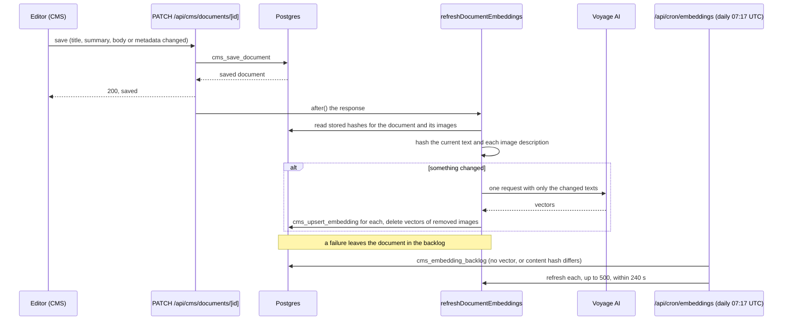
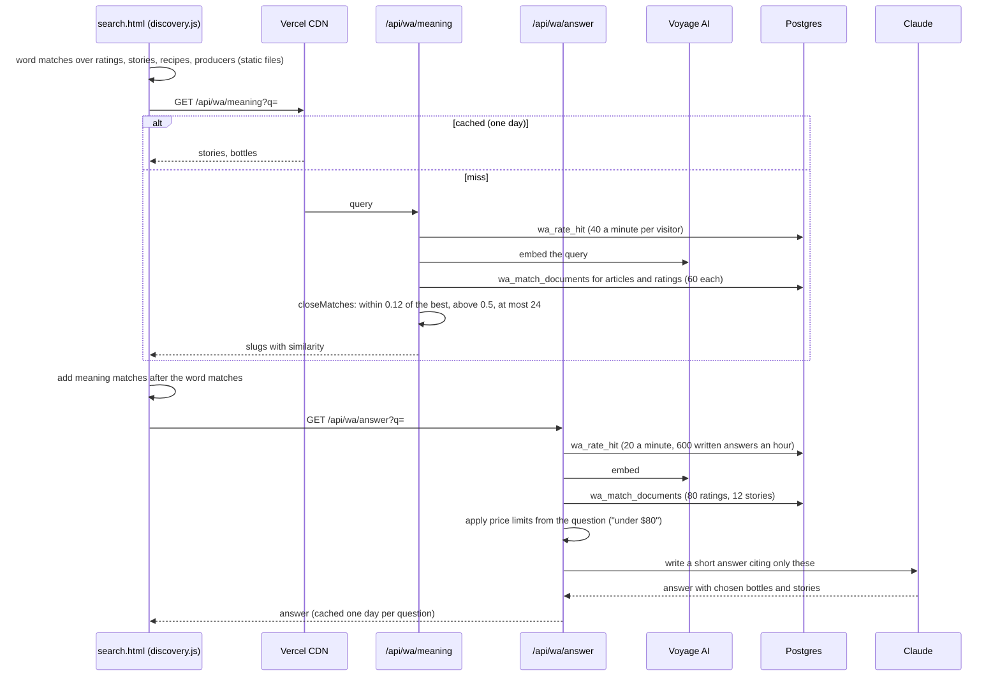

# Indexing and search

Content is found three ways: by words (Postgres full-text search, in the CMS), by meaning (embeddings in pgvector, in the CMS and on the site), and by search engines (sitemaps, the RSS feed, the Google News sitemap, `robots.txt`, `llms.txt`). This page covers all three.

## Embeddings

### What is stored

- Provider: Voyage AI, model `voyage-3` (override with `VOYAGE_EMBEDDING_MODEL`), 1024 dimensions. Needs `VOYAGE_API_KEY`; without it semantic search is off and the CMS falls back to word search. Code: `src/lib/editorial/server/embeddings.ts`.
- Table `cms_embeddings` (migration `20261101120000_cms_embeddings.sql`): one row per document (`kind = 'document'`) and one per described image (`kind = 'media'`, with `media_index`), with the brand, a `content_hash`, the model name and a `vector(1024)`. An HNSW index with cosine distance (`cms_embeddings_hnsw_idx`) makes nearest-neighbour search fast. Service role only; browser roles have no access.
- What is embedded:
  - A document: title, summary, section, tags and body text, up to 12,000 characters (`documentEmbeddingText`).
  - An image: caption, alt text, credit and the AI vision description (style, mood, tags, subjects, colours, palette names) (`mediaEmbeddingText`). Image descriptions come from `scripts/describe-media.ts` (the `describe` maintenance task) or the editor's Describe button.
- The migration only runs where pgvector exists, so the local PGlite test database skips it.

Why embeddings: readers search the way they talk ("something smoky for a cold night") and a tasting note rarely uses the reader's words. Meaning matches find the bottles and stories that fit even when no word matches. Keeping vectors in Postgres beside the documents means one database, one permission model, and joins with publication state.

### How embeddings stay current

- **On save and on publish.** The document routes (`src/app/api/cms/documents/[id]/route.ts`, `.../publish/route.ts`) and document creation call `refreshDocumentEmbeddings` in `after()`, so the editor never waits for Voyage. It embeds only what changed, by comparing hashes, in one batched request, and removes vectors for images that are gone.
- **Daily catch-up.** `vercel.json` runs `GET /api/cron/embeddings` at `17 7 * * *`. It needs `CRON_SECRET` as a bearer token (Vercel sends it; without the secret the route refuses every call). It reads `cms_embedding_backlog` (documents with no vector or a stale hash), refreshes up to 500 in a 240-second budget, and logs failures. This picks up imports, scripts that write directly, and saves whose refresh failed.
- **Full backfill.** `scripts/embed-content.ts --brand wa [--limit N] [--apply]`, also the `embed` task of `cms-maintenance.yml`.

Watch out: the document hash covers title, summary and body text only (`documentContentHash`, matched by `cms_embedding_backlog`). A change to section or tags alone does not re-embed the document, although both are part of the embedded text; image vectors do refresh when their descriptions change. Edit the text, or delete the document's vector row, to force it. Never run two maintenance jobs at once (see `AGENTS.md`).

### Matching functions

| Function | Used by | What it does |
|---|---|---|
| `cms_match_embeddings(brands, query, kind, limit)` | CMS search | Nearest vectors across the given brands, any state, documents or images. Editors only: no public route reads it. |
| `wa_match_documents(query, kinds, limit, exclude)` | `/api/wa/meaning`, `/api/wa/answer`, `/api/wa/ask`, `/api/wa/bottles-like`, `/api/wa/similar` (through `matchDocuments` in `src/lib/wa/semantic.ts`) | Whisky Advocate only, live only (published, and `published_at` empty or past), with a slug, of the chosen kinds (`rating`, `article`, `legacy_record`). Filters inside the scan with HNSW iterative scan (`hnsw.ef_search = 400`, `relaxed_order`) so a filtered query still fills its limit. Migrations `20261102200000_wa_match_documents.sql` and `20261103180000_wa_match_live_only.sql` (adds the `published_at` test). `matchDocuments` also re-checks each match with `liveIds` (`src/lib/wa/live.ts`) and asks for a few extra, so a scheduled story never surfaces even before that migration is applied. |
| `cms_upsert_embedding(...)` | the refresh | Insert or update one vector, keyed by document, kind and image index. |
| `cms_embedding_backlog(brands, limit)` | the cron and the backfill | Documents to embed, newest edited first. |

Why a second matching function: `cms_match_embeddings` returns every kind and state, and filtering its top rows afterwards threw most of them away. `wa_match_documents` filters while scanning.

## Search in the CMS

`GET /api/cms/search` (`src/app/api/cms/search/route.ts`) searches what the signed-in user's publications allow, in up to four scopes at once:

- **Documents**: `cms_search_documents`, Postgres full-text search (`websearch_to_tsquery('english')`) over a weighted `search_text` (title A; byline, summary and slug B; body C; media text D), plus a title or byline substring boost. Migration `20261031120000_cms_search.sql`.
- **Images attached to stories**: `cms_search_media`, over captions, file names and descriptions.
- **The gallery library**: `cms_search_library`, over the Morweb gallery files with their SEO names, titles, keywords, alt text and descriptions (migration `20261101220000_cms_media_names.sql`, kept current by the `cms_media_files_search_vector` trigger). A file found here can be dropped into any story.
- **Keywords**: `cms_search_keywords`, tags and categories with their document counts.

When Voyage is configured, semantic matches from `cms_match_embeddings` (documents, or images for an image search) are blended with the word results by reciprocal rank fusion (`reciprocalRankFusion` in `src/lib/editorial/rank.ts`). This is how "moody amber bar photo" finds images by look and style.

The search page is `/cms/search`, and the command palette and the assistant call the same route.

## Search on the site

### Search by meaning

- `/api/wa/meaning` makes no model call. `closeMatches` (`src/lib/wa/meaning.ts`) keeps only matches close to the best one, so a query that matches nothing well returns little rather than noise. Results are cached a day at the edge per normalised query.
- `/api/wa/answer` writes the answer in the magazine's voice from the matched ratings and stories only (model `WA_ANSWER_MODEL`). When the hourly budget (`WA_ANSWER_HOURLY`, default 600) is spent, readers get the matched bottles and stories without the written answer.
- The site search overlay on every page (`site.js`, slash or Cmd+K) searches the static files as you type.
- Buying-guide picks (`editorial.js`, through `/api/wa/meaning`) and the Ask chat (`/api/wa/ask`, 40 rating matches for the question within any price limit it names) use the same meaning matches.

### Similar stories and bottles

- `/api/wa/similar?slug=`: the story's own vector against every other live story's (`wa_match_documents` with kinds `article` and `legacy_record`, excluding itself), returned as ids and slugs; the page fills in titles from its index. Empty until the story is embedded, and empty for a story that is not live yet (its page is a 404).
- `/api/wa/bottles-like?slug=`: for a live rating, the 100 live ratings whose notes read closest, re-ranked by flavor profile and spread across houses (`rankSimilar` in `src/lib/wa/semantic.ts`, profiles from `metadata.flavor`).

### Recommendations

`POST /api/wa/recommend` (`src/app/api/wa/recommend/route.ts`): the page sends what it is about and the candidate bottles its own index found (bottles named in the text, the house, the style). Claude (`WA_RECOMMEND_MODEL`) picks the ones a reader would want beside that page, with a line of why. Results are stored in `wa_recommendations` (migrations `20261101150000_wa_recommendations.sql`, `20261101160000_wa_recommendations_kinds.sql`; kinds `story`, `cocktail`, `bottle`, `producer`) keyed by the page's content and candidates, so a page costs one model call until it changes.

Why: picks an editor would choose read better than a nearest-neighbour list, and storing them keeps the cost to one call per page version.

## Search engines

All of these are route handlers under `src/app/wa` and `src/app`, built from the database by `src/lib/wa/feeds.ts` and `listDocs` in `src/lib/wa/seo.ts`. On preview deployments (no delivery) they answer 503. The paths below are the development host's; on whiskyadvocate.com (a root host) each is served without `/wa` (`/sitemap.xml`, `/feed.xml`, `/news-sitemap.xml`) and every URL it lists is in the root form (see [seo-and-cutover.md](seo-and-cutover.md)).

| URL | Contents | Cache |
|---|---|---|
| `/wa/sitemap.xml` | Sitemap index: stories, ratings, section pages | 1 hour |
| `/wa/sitemap-stories.xml` | Every published story and page at `/wa/<slug>`, with its lead picture (image sitemap) | 1 hour, swr 1 day |
| `/wa/sitemap-ratings.xml` | Every published rating at `/wa/<slug>`, with last modified | 1 hour, swr 1 day |
| `/wa/sitemap-pages.xml` | The section pages (`SECTION_PAGES`) | 1 day |
| `/wa/news-sitemap.xml` | Google News: editorial stories from the last two days, publication named Whisky Advocate, never paid content | 1 minute, swr 1 minute |
| `/wa/feed.xml` | RSS 2.0: the 50 newest editorial stories with summary, author, section and lead picture | 1 minute, swr 1 minute |
| `/robots.txt` | Allows search engines and AI answer engines that cite their sources; disallows training-only crawlers (`GPTBot`, `CCBot`, `Google-Extended`, `ClaudeBot` and others) and the private paths (`/cms`, `/admin`, `/api/`, ...); lists both sitemaps. On a root host the app is closed by whole segment and `/api/media/` and `/api/wa/` stay open (`src/lib/wa/robots.ts`) | 1 hour |
| `/llms.txt` | A plain map of the site for AI assistants, with the newest stories | |

Rules every list follows:

- Only published documents with a slug, and not marked no-index (`isNoIndex`).
- **A scheduled story is hidden until its time.** Every read adds `published_at is null or published_at <= now()`, so a story the CMS scheduled appears in sitemaps and feeds when it goes live, not before. The rule lives in `src/lib/wa/live.ts` (`onlyLive` for a `cms_documents` query, `onlyLiveJoined` for an embedded one, `isLive` and `liveIds` for rows already fetched) and covers search by meaning, answers, Ask, similar stories and bottles, the shelf scan and the public ratings API too.
- **Newest first merges two kinds of dates.** Imported stories carry the old site's date (`metadata.legacy_dates`); stories published from the CMS carry `published_at`. `listDocs` reads the imported ones by legacy date and the CMS ones by `published_at`, then merges them by the effective date (`docDates`). Before this, a new CMS story sorted last and never reached the feed or Google News.
- Sponsored stories are left out of Google News (`isSponsored`, the same rule that labels them on the site).
- URLs use `WA_SITE_ORIGIN` when set, so after the domain move they name whiskyadvocate.com.

Watch out: the development host sends `X-Robots-Tag: noindex, nofollow`, so its sitemaps are not meant for Search Console. Submit the sitemaps on the production domain after the move ([seo-and-cutover.md](seo-and-cutover.md)).

## Changing it

- New embedding text or model: change `documentEmbeddingText` or `EMBEDDING_MODEL`. The refresh compares the stored model name, so a model change re-embeds every document on the next pass; run the backfill rather than waiting for the daily budget.
- New site search behaviour: `discovery.js` for word matches, `closeMatches` for meaning thresholds (`floor`, `spread`, `limit`).
- New sitemap or feed rule: `src/lib/wa/feeds.ts`, and keep the scheduled-time filter.
- New public read of `cms_documents` (or a join to it): filter with `onlyLive` / `onlyLiveJoined` from `src/lib/wa/live.ts`, or check fetched rows with `isLive`; a `publication_state = 'published'` test alone lets a scheduled story out early.
- **Drafts and review items never reach a public answer, not even by slug.** A public read that has to name what is *not* live (the takedown lists on `/api/wa/latest`) intersects it with the public static files first, so it can only name what those files already show ([website.md](website.md), "The takedown rule"). The site applies those lists to the static story index, the archive and both ratings files before search, the finder or any list sees them, and the server-rendered producer pages crawlers index leave out the same taken-down ratings (`removedRatingSlugs`); if the route fails, the static files are used as they are, as before.
