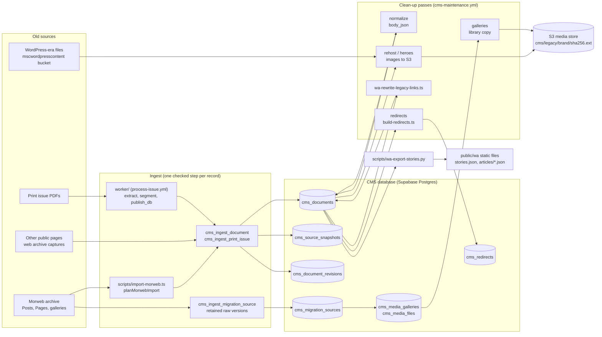
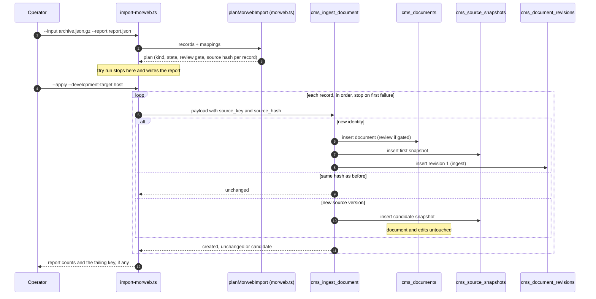

# Migration: how the old site's content came into the CMS

This page explains how Whisky Advocate's content moved from the old Morweb site (and its WordPress-era files, its
print issues and other public pages) into the CMS, and how it reaches the new website. It covers what each step is,
how it works, why it was built that way, and how to run it again.

Related pages: [docs/migration-import.md](../migration-import.md) (the Morweb importer in detail),
[docs/migration-sources-api.md](../migration-sources-api.md) (the retained source readers),
[docs/cms-development.md](../cms-development.md) (setting up a database and the print worker), and
[catalog-and-media.md](catalog-and-media.md) (ratings, tags, image naming and other cataloging passes).

## The pipeline at a glance



The rule behind every step: **preserve first, organize later**. Nothing in the archive is thrown away, nothing is
published by an import, and an editor's edit is never overwritten by a later import.

## 1. The Morweb import

**What it is.** `scripts/import-morweb.ts` converts the preserved Morweb export (Posts and Pages) into CMS documents.
The mapping logic lives in `src/lib/cms/morweb.ts` (`planMorwebImport`), and the write is the database function
`cms_ingest_document`.

**How it works.**

- Every Morweb record keeps a stable identity: `Posts:{id}` or `Pages:{id}` as the `source_key`, with
  `source_system = 'morweb'`. The unique key is `(brand, kind, source_system, source_key)`.
- The record's kind comes from its Morweb category: Ratings (category 50) become `rating`, editorial categories become
  `article`, Top 20 becomes `collection_entry`, Clubs `directory_entry`, Glossary `glossary_entry`, TopShelf
  `product_review`, and anything ambiguous becomes `legacy_record` with a required review gate. Pages become `page`.
  The full table is in [migration-import.md](../migration-import.md#what-is-mapped).
- Source HTML is stored unchanged in `body_html`. Categories, tags, SEO fields, media and gallery IDs and the original
  dates go into `metadata`, and the untouched record goes into a source snapshot.
- Published state is kept only when the record has no review gate. Original dates are kept as source metadata; the
  importer does not set `published_at` (the site reads the old date from `metadata.legacy_dates`).

**The database side.** `cms_ingest_document(payload, actor)` is atomic per record:

- the first time, it creates the document, its first source snapshot (`cms_source_snapshots`) and revision 1
  (`cms_document_revisions`, reason `ingest`);
- an unchanged replay (same source hash) does nothing, so a rerun is safe;
- a changed source version is stored as a new snapshot marked as a candidate. The document, its edits, its state and its
  URL stay as they are; an editor can adopt the new text from the editor's Sources tab.



**Why.** The archive is the only complete record of the old site. Keeping a stable source identity, the raw snapshot and
an append-only revision history means the import can be rerun at any time, a later fix never erases an editor's work, and
any field can be traced back to what Morweb actually held.

**Run it.** Dry run first, then apply to the target named on the command line:

```sh
node --import tsx scripts/import-morweb.ts --input /private/migration/content_archive.json.gz --report /private/migration/report.json
node --import tsx scripts/import-morweb.ts --input ... --report ... --apply --development-target <database host>
```

Apply reads `CMS_IMPORT_SUPABASE_URL` and `CMS_IMPORT_SERVICE_ROLE_KEY` from the environment only (never `.env`), and
`--development-target` must match that URL's host exactly (`scripts/lib/target.ts`). Records with review gates stop the
apply unless `--allow-held` is given.

**Watch out for.** Changing the mapping changes source hashes. To add records to an existing import, build the full plan,
then apply only the new identities (see "Expand an earlier import" in [migration-import.md](../migration-import.md)).

## 2. Review gates

**What it is.** `metadata.review = { required, reasons[] }`. A gated document is held in `review`, and cannot be
published by any save.

**How it works.** The trigger `cms_guard_retained_document` validates the gate, forces a gated insert into review, and
refuses any ordinary save that changes the gate or publishes the document. Only `cms_resolve_review`
(migration `20261101160000_cms_review_resolution.sql`) can clear a gate: it sets a transaction-local flag, clears the
reasons for one document, may publish it in the same step, and writes an append-only audit row with the actor and a note.

**Why.** Imports do not decide what is publishable. Missing bodies, missing scores, ambiguous types and route
collisions need a person.

## 3. Web archive captures

**What it is.** Content observed on other public Whisky Advocate pages that never lived in Morweb, stored with
`source_system = 'web_archive'` (migration `20261030174537_cms_web_archive_sources.sql`).

**How it works.** Every capture arrives with a required review gate (enforced by a check and the guard trigger). The source
payload keeps the source URL, the capture time and the original text. Clearing the gate is `cms_resolve_review` only.

**Why.** Captured pages are evidence, not edited copy. Holding them for review stops a scraped page from going live by
accident.

## 4. Retained migration sources

The raw material behind the import (every Morweb version, page editor contexts, menus, gallery definitions, media file
records) is kept append-only in `cms_migration_sources`, written by `cms_ingest_migration_source` and
`cms_ingest_migration_sources_batch`. Service role may insert and read; nobody can update or delete. How to read them
is in [migration-sources-api.md](../migration-sources-api.md).

## 5. Print intake

**What it is.** New print issues enter the CMS from the PDF.

**How it works.** The CMS uploads the PDF to private S3 and dispatches `.github/workflows/process-issue.yml` with the
issue id, an intake token and the PDF key. The worker in `worker/` validates the inputs, claims the issue attempt, then:

1. `extract.py` reads the pages;
2. `segment.py` splits them into articles;
3. `publish_db.py` stores source assets and calls `cms_ingest_print_issue` in one transaction.

Each article gets a printed-folio identity (`issue:<uuid>:folio:<page>`). New print articles always start in `review`;
a rerun of the same issue adds candidates and never replaces edits. Nothing in this path publishes.

**Why.** The magazine is a source like any other: it gets the same identity, snapshot and review rules as the archive.

## 6. Body normalization

**What it is.** `scripts/normalize-bodies.ts` turns stored `body_html` (legacy exports, print, pasted markup) into the
structured block document `body_json` and a clean HTML rendering, using `src/lib/cms/blocks.ts`.

**How it works.** Dry run by default. `--apply` writes `body_json` through `cms_set_body_json`, which does not add an
editorial revision (it is a derived form). `--rewrite-html` also saves the normalized HTML as an editorial revision.

**Run it.** `cms-maintenance.yml` task `normalize` (it passes `--only-missing`), or
`node --import tsx scripts/normalize-bodies.ts --brand wa --apply --development-target <host>`.

## 7. Media rehosting

**What it is.** Every picture moves off the old hosts into the platform's own S3 store, so nothing depends on
whiskyadvocate.com, the WordPress bucket or the Wayback Machine.

**How it works.**

- `scripts/rehost-media.ts` finds legacy image URLs in bodies (and lead photographs with `--heroes`), downloads them from
  the allowed hosts only, stores each once content-addressed at `cms/legacy/<brand>/<sha256>.<ext>`, writes WebP and AVIF
  renditions at three widths, detects a focal point, adds the image to the document's `metadata.media`, and rewrites the
  body to the stable `/api/media/<document id>/<index>` URL. The backlog read is `cms_rehost_backlog`, which lifts the
  statement timeout for its own scan.
- `scripts/wa-rehost-static.ts` does the same for the static site's own data files (`cocktails.json`, `top20.json`,
  `videos.json`, `ninety.json`, `stories.json`, `stories-archive.json`) and rewrites references to
  `/api/wa/asset/<sha256>.<ext>`.

**Why.** Content addressing means one copy per picture, however many stories use it, and a stable URL that never
breaks when the old site goes away.

**Run it.** `cms-maintenance.yml` tasks `rehost` and `heroes`, with the `hosts` input listing the hosts that may be
fetched (default `whiskyadvocate.com,mscwordpresscontent.s3.amazonaws.com,www.maltadvocate.com,web.archive.org`). Apply needs
`AWS_REGION`, `AWS_ACCESS_KEY_ID`, `AWS_SECRET_ACCESS_KEY` and `S3_BUCKET`.

## 8. The Morweb gallery library

**What it is.** The whole Morweb gallery library, kept as a browsable catalog at `/cms/media`: `cms_media_galleries` and
`cms_media_files` (migration `20261101210000_cms_media_galleries.sql`), filled from the retained sources
(`gallery_definition`, `media_file`).

**How it works.** `scripts/wa-gallery-import.ts` takes each `pending` file, downloads it from whiskyadvocate.com, stores
it once in the same content-addressed store, and records the hash, key and size (`stored`). A file that cannot be
fetched is marked `failed` with the reason; `--retry-failed` tries again. `cms_media_file_usage` finds the stories that use
a file. Web names and search come later (see [catalog-and-media.md](catalog-and-media.md#image-naming)).

**Run it.** `cms-maintenance.yml` task `galleries`.

## 9. Legacy link rewriting

**What it is.** `scripts/wa-rewrite-legacy-links.ts` points every link to an old whiskyadvocate.com page at its page on
the new site.

**How it works.** Each linked path goes through the redirect map (`cms_redirects`: the row's `target_path`, else the
document's canonical path when it is published), then a few known families (Top 20 years, tags, glossary, WhiskyFest),
then a published slug matching the last path segment. A link that matches nothing is unwrapped: the words stay and the
dead link goes. `--static` also covers the static site's JSON files.

**Run it.** `node --import tsx scripts/wa-rewrite-legacy-links.ts [--static]`, then with `--apply --development-target <host>`.

## 10. Redirects for the old URLs

**What it is.** `cms_redirects` maps every old whiskyadvocate.com path to its new home, so search rankings and
bookmarks carry over.

**How it works.**

- `scripts/build-redirects.ts` derives a 301 row from each migrated document's public URL and recorded aliases, and a
  410 (gone) row for retired pages. `--apply` inserts rows (existing paths are skipped); `--export` writes
  `vercel`, `nginx`, `cloudfront` or `json`.
- A row either names a `target_path` or a `document_id`; for a document, the target is computed live from
  `cms_canonical_path` (so a renamed slug follows automatically). An editor's slug change adds a `slug_change` row.
- The proxy (`src/proxy.ts`) answers any path the app does not serve itself by calling `cms_resolve_redirect`, and
  caches the answer for five minutes. Old `/tag/<name>` pages go to the filtered story list.
- Hosts compare without a leading `www.` (migration `20261103161000_cms_redirect_host_www.sql`), so
  `www.whiskyadvocate.com` and `whiskyadvocate.com` match the same rows.

On 2026-11-03 the map held 12,516 permanent (301) rows and 356 gone (410) rows, all imported for host
`whiskyadvocate.com`. Checked against Search Console's pages since July, the rows cover 3,078 of 3,111 pages
with clicks, carrying 93% of the clicks; the rest are the home page, tag pages and a handful of stories published on
the old site after the last import.

**Run it.** `cms-maintenance.yml` task `redirects`.

**Watch out for.** To test old URLs on a staging host before the domain moves, set `REDIRECT_HOST_ALIASES`
(`staging.host=whiskyadvocate.com`). The resolver counts hits (`hit_count`), so audits should read the table, not call
the function in bulk.

## 11. The static export to the website

**What it is.** `scripts/wa-export-stories.py` writes the website's story index from the CMS: `public/wa/stories.json`
(the last 640 days), `stories-archive.json` (older), `articles/<00-63>.json` (bodies sharded by slug hash) and
`sponsored.json` (the paid stories).

**How it works.** It reads every published article and legacy record through the Supabase management API, files each into
a section (tags and title rules), picks the dek (the editors' description from before the SEO pass, else the excerpt),
the hero (the rehosted lead), reading time, caption and credit, AI tags and the sponsor flag. Fields the old index carried
(guide kinds, travel regions) are kept per slug from `scripts/data/wa-story-fields.json`. A story without a date is left out.

Since 2026-11-03, stories published from the CMS also reach the site without waiting for this export: `/api/wa/latest`
returns them in the same shape and `site.js` merges them over the static index (see the publishing and delivery pages).

**Run it.** `python3 scripts/wa-export-stories.py public/wa`, then commit the regenerated files. Regenerate from the
current CMS; never restore an older copy (rule in `AGENTS.md`).

## Running the clean-up passes safely

All the passes above that write to the database run from GitHub Actions as **CMS maintenance**
(`.github/workflows/cms-maintenance.yml`), with the same secrets the print worker uses, so credentials never leave
GitHub. Pick a `task`, a `brand`, a `limit` per pass and how many `passes`; nothing is written unless `apply` is ticked.

Task names: `rehost`, `heroes`, `captions`, `describe`, `bottles`, `normalize`, `redirects`, `embed`, `tags`,
`galleries`, `names`, `names-preview`, `names-retry`, `names-dedupe`, `names-dedupe-preview`, `seo`, `seo-preview`,
`seo-fix`.

- **Never run two maintenance jobs at once.** The workflow only stops the same task and brand from overlapping; four jobs
  at once exhausted the database's connection pool and took the site down.
- Every script is dry run by default and prints a summary; read it before ticking `apply`.
- Each pass stops early when it reports nothing left (`"documents": 0` or `"scanned": 0`).
