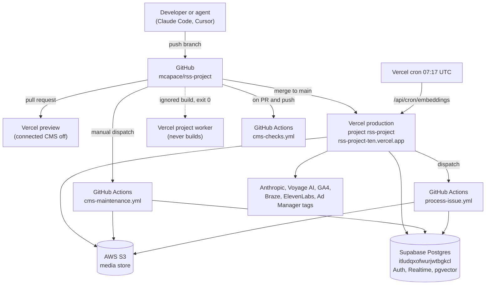
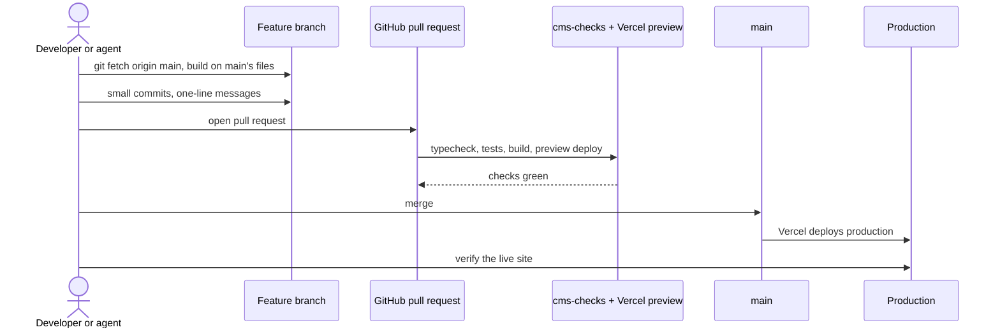

# Operations: hosting, jobs, configuration, deploys

How the CMS and the Whisky Advocate site run, what each setting turns on, and how a change gets to production. For the code, see [cms.md](cms.md) and [data-model.md](data-model.md).

## Where things run

- **Vercel, project `rss-project`.** One Next.js 16 app serves the CMS (`/cms`, `/api/cms`), the public site (`/wa`, static files in `public/wa` plus server routes under `src/app/wa` and `/api/wa`), the delivery and feed APIs, and the legacy redirect proxy (`src/proxy.ts`). `main` deploys to production at `rss-project-ten.vercel.app`; every pull request gets a preview.
- **The dev host is kept out of search.** `next.config.ts` sends `X-Robots-Tag: noindex, nofollow` on every `*.vercel.app` host, so the development site never competes with whiskyadvocate.com. A custom production domain does not match that rule, so it is indexable as soon as it points here. Canonical URLs use `WA_SITE_ORIGIN` when set.
- **Vercel project `worker`.** A second project linked to the same repository. Its Ignored Build Step is `exit 0`, so it never builds and its pull request check reports "Canceled by Ignored Build Step", which GitHub treats as passing. The print worker itself (`worker/`, Python) runs in GitHub Actions, not on Vercel.
- **Supabase project `itludqxofwurjwtbgkcl`.** Postgres (content, catalog, redirects, embeddings with pgvector), Auth (editor sign-in), Realtime (live co-editing).
- **AWS S3.** One bucket (`S3_BUCKET`) holds print PDFs, extracted images and the re-hosted legacy media. Legacy files are content-addressed (`cms/legacy/<brand>/<sha256>.<ext>`) so each file is stored once. The app serves them through `/api/media/...` (CMS and story images, with renditions) and `/api/wa/asset`.

## Scheduled and manual jobs

| Job | Where | When | What it does |
|---|---|---|---|
| Embeddings catch-up | `vercel.json` cron → `/api/cron/embeddings` | daily 07:17 UTC | Embeds documents and described images that changed or were missed. Requires the `CRON_SECRET` bearer. Saves already refresh embeddings right after the response; this catches failures. |
| CMS checks | `.github/workflows/cms-checks.yml` | every pull request, pushes to `main` | `npm ci`, typecheck, `npm test`, `npm run build`, and the Python worker's unit tests. |
| CMS maintenance | `.github/workflows/cms-maintenance.yml` | manual (`workflow_dispatch`) | Runs one maintenance script against the content database (tasks below). |
| Print issue | `.github/workflows/process-issue.yml` | dispatched by `/api/process` when a PDF is uploaded | Validates inputs, claims the issue, downloads the PDF from S3, extracts, segments by the table-of-contents pages, and creates CMS review candidates (`worker/publish_db.py`); marks the issue failed on error. One run per issue at a time; 45 minute limit. |

### CMS maintenance tasks

Pick a task, a publication (`wa`, `ws`, `ca`, `mw`), a batch size and the number of passes. Without `apply` every task is a dry run. With `apply`, scripts write only to the database named twice: the `CMS_IMPORT_SUPABASE_URL` secret and an explicit `--development-target` flag that must match its host (`scripts/lib/target.ts`).

| Task | Script | What it does |
|---|---|---|
| `rehost` | `rehost-media.ts` | Copies images still linked from legacy hosts into S3 and rewrites the bodies. |
| `heroes` | `rehost-media.ts --heroes` | The same for lead images. |
| `captions` | `restore-captions.ts` | Restores captions lost in the import. |
| `describe` | `describe-media.ts` | AI descriptions of images, for search and alt text. |
| `bottles` | `bottle-images.ts` | Bottle shots for ratings. |
| `normalize` | `normalize-bodies.ts --only-missing` | Converts legacy HTML bodies to the block structure (`body_json`). |
| `redirects` | `build-redirects.ts` | Builds the legacy URL map in `cms_redirects`. |
| `embed` | `embed-content.ts` | Embeds the backlog (text and described images). |
| `tags` | `tag-stories.ts` | AI tags, summary and search phrases for stories. |
| `galleries` | `wa-gallery-import.ts` | Imports the Morweb gallery library and copies files to S3. |
| `names`, `names-preview`, `names-retry`, `names-dedupe`, `names-dedupe-preview` | `wa-media-name.ts` | Writes web names (SEO name, title, alt, description, keywords) for gallery files; preview, retry failures, merge duplicates. |
| `seo`, `seo-preview`, `seo-fix` | `wa-seo-pass.ts` | The SEO and GEO pass over content (titles, descriptions); preview a few, or fix flagged ones. |

Rule from `AGENTS.md`: never run two maintenance jobs at once. Four at once exhausted the database's connection pool and took the site down.

## Configuration

Environment variables are set in Vercel (and GitHub secrets for the workflows). Only names are listed here; values live in Vercel and GitHub and are never written to the repository.

| Variable | Turns on |
|---|---|
| `SUPABASE_URL`, `NEXT_PUBLIC_SUPABASE_URL` | The database and Auth endpoint. |
| `SUPABASE_SECRET_KEY` or `SUPABASE_SERVICE_ROLE_KEY` | The server's service-role access (`src/lib/cms/db.ts`). |
| `SUPABASE_PUBLISHABLE_KEY`, `NEXT_PUBLIC_SUPABASE_PUBLISHABLE_KEY`, `NEXT_PUBLIC_SUPABASE_ANON_KEY` | Editor sign-in and Realtime in the browser. |
| `VERCEL_ENV`, `CMS_ENABLE_CONNECTED_PREVIEW` | On a preview the connected CMS and delivery are off unless `CMS_ENABLE_CONNECTED_PREVIEW=true` (`src/lib/cms/runtime-config.ts`). |
| `AWS_REGION`, `AWS_ACCESS_KEY_ID`, `AWS_SECRET_ACCESS_KEY`, `S3_BUCKET` | The media store. |
| `ANTHROPIC_API_KEY` or `ANTHROPIC_AUTH_TOKEN` | The CMS assistant and the site's AI features (answers, recommendations, shelf scan, tags, SEO pass). |
| `WA_ASK_MODEL`, `WA_ANSWER_MODEL`, `WA_RECOMMEND_MODEL`, `WA_TAG_MODEL`, `WA_SEO_MODEL`, `WA_META_MODEL`, `WA_PLACES_MODEL`, `WA_FLAVOR_MODEL`, `SHELF_SCAN_MODEL`, `DESCRIBE_MODEL`, `MEDIA_NAME_MODEL` | Override the model a feature or script uses. |
| `WA_ANSWER_HOURLY` | Hourly cap on the site's AI answer panel (default 600). |
| `VOYAGE_API_KEY`, `VOYAGE_EMBEDDING_MODEL` | Embeddings for search by meaning (default `voyage-3`, 1024 dimensions). Without the key, meaning search is off and keyword search still works. |
| `CRON_SECRET` | Authorizes the embeddings cron. |
| `GOOGLE_CLIENT_ID`, `GOOGLE_CLIENT_SECRET`, `GOOGLE_REDIRECT_URI`, `GOOGLE_WORKSPACE_DOMAIN` | Connecting a Google account for GA4 from `/cms/audience`. |
| `GA4_SERVICE_ACCOUNT_JSON`, `GA4_PROPERTY_ID_WA`, `GA4_PROPERTY_ID_WS`, `GA4_PROPERTY_ID_CA`, `GA4_PROPERTY_ID_MW` | GA4 through a service account instead. |
| `BRAZE_REST_ENDPOINT`, `BRAZE_API_KEY`, `BRAZE_CAMPAIGN_<BRAND>_<KIND>`, `BRAZE_CAMPAIGN_<BRAND>`, `BRAZE_CAMPAIGN_ID` | Newsletter sends from the CMS. |
| `BRAZE_REST_API_KEY` | The public site's newsletter sign-up form (`/api/wa/newsletter`). |
| `PUBLIC_SITE_URL` | Absolute links in newsletter emails. |
| `ELEVENLABS_API_KEY`, `WA_TTS_VOICE`, `WA_TTS_MODEL` | "Listen" on story pages. |
| `WA_SITE_ORIGIN` | The origin used in canonical URLs and structured data (the production domain). |
| `REDIRECTS_AT_EDGE` | Set to `false` to stop the proxy answering legacy URLs. |
| `REDIRECT_HOST_ALIASES` | `staging.host=legacy.host,...`: lets a staging host answer as whiskyadvocate.com, to test old URLs before the domain moves. |
| `LEGACY_RSS_HOSTS` | Hosts the legacy RSS reader may fetch. |
| `GITHUB_TOKEN`, `GITHUB_REPO`, `GITHUB_WORKFLOW_REF` | Lets `/api/process` dispatch the print workflow. |
| `CMS_IMPORT_SUPABASE_URL`, `CMS_IMPORT_SERVICE_ROLE_KEY` | Maintenance and import scripts (in GitHub secrets, mapped from `SUPABASE_URL` and `SUPABASE_SERVICE_ROLE_KEY`). |
| `RUNWAYML_API_SECRET` | Only for `scripts/house-ads/runway.mjs`, which makes the house-ad film loops. |
| `PRINT_*`, `WA_EXPORT_*`, `WA_TEST_*`, `WA_CHROMIUM_PATH`, `WA_AXE_PATH` | Set by the print workflow and local scripts; not app settings. |

## Applying a database migration

1. Add a new file in `supabase/migrations/` named `YYYYMMDDHHMMSS_description.sql`. Never edit one that has been applied.
2. Write it to be safe to run once on production: additive, guarded with `IF NOT EXISTS` where it helps, functions with `SET search_path TO ''`, write functions revoked from `PUBLIC`, `anon` and `authenticated` and granted to `service_role`.
3. Add or extend a test in `src/lib/cms/__tests__/database.test.ts`; it runs every migration in order in PGlite.
4. Run `npm test`.
5. Apply it to production through the Supabase SQL editor, CLI or management API. **This changes production and needs the owner's approval first.** Apply it before (or together with) the deploy that calls it; code that calls a missing function reports `setup_required` rather than failing silently.

## Tests

- `npm test` runs Vitest over `src/**` (around 300 tests): route handlers with mocked databases, the editorial data layer, the redirect engine, the feeds, the house-ad and site helpers, and `src/lib/cms/__tests__/database.test.ts`.
- The database test starts an in-memory PGlite Postgres, creates the Supabase roles (`anon`, `authenticated`, `service_role`) and a stub `auth.jwt()`, applies every migration in order, and checks the contract: immutable history, review gates, ingest idempotency, browser roles locked out, publishing, scheduling, slugs and redirects. Extensions it lacks (pgvector, Realtime) are skipped by the migrations themselves.
- `npm run test:worker` runs the Python print worker's unit tests.
- `npm run typecheck`, `npm run lint` and `npm run build` must pass; `cms-checks.yml` runs the typecheck, the tests and the build on every pull request (lint is run locally).
- Public site changes are checked in a browser (Playwright against `public/` served locally, with `/api/**` proxied to production) before merging.

## How a change ships

Rules from `AGENTS.md`, because two agents (Claude Code and Cursor) commit to `main`, often minutes apart:

- Before editing, `git fetch origin main` and build on main's version of every file you touch. Never copy a whole folder or stylesheet from a scratch directory over `public/wa`.
- Append new CSS in its own commented block instead of rewriting a stylesheet, and check the diff for removed lines you did not mean to remove (`git diff origin/main... -- public/wa/site.css | grep '^-'`).
- Keep commits small, each described in one line.
- `public/wa/gen` is scratch; do not commit it.
- Data files (`stories.json`, `stories-archive.json`, `articles/*.json`, `ratings.json`, `top20.json`) are regenerated by scripts from the current export, never restored from an older copy.
- Never run two CMS maintenance jobs at once.
- This repository uses a Next.js version with breaking changes; read the guide in `node_modules/next/dist/docs/` before writing Next.js code.

## What to watch out for

- Previews never write to production unless someone sets `CMS_ENABLE_CONNECTED_PREVIEW`; leave it off unless the preview points at a development database.
- The site's static data files are exports. Stories published from the CMS appear immediately through `/api/wa/latest`, but the static index catches up only when `scripts/wa-export-stories.py` is run and committed.
- Story pages are cached at the edge for two minutes and served stale for up to a day while refreshing; a correction shows on the next request after two minutes.
- Secrets that have appeared in a session or a log should be rotated in Vercel and GitHub; never paste them into the repository or docs.
