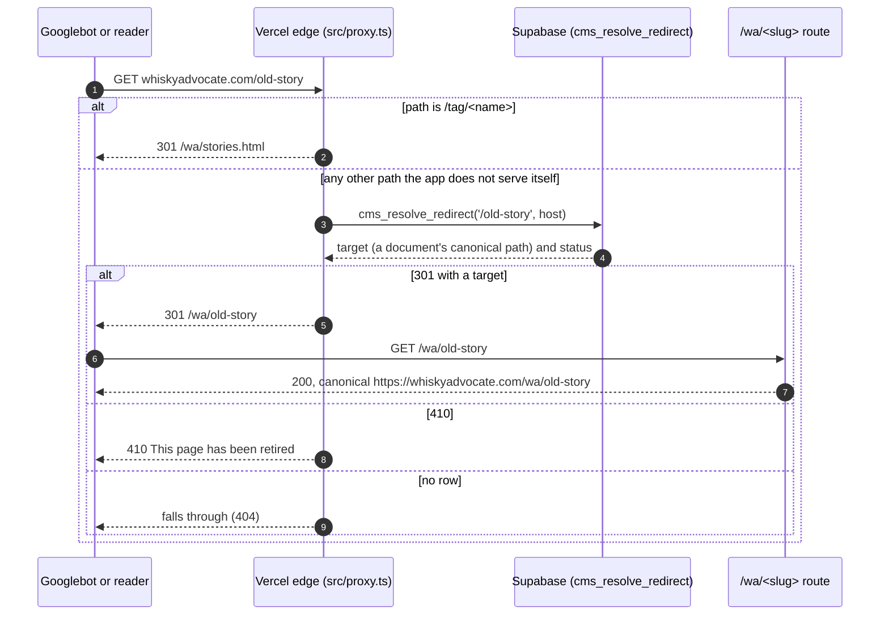

# SEO, redirects and the switch to whiskyadvocate.com

What keeps search rankings when whiskyadvocate.com moves from the old site to this one: the redirect map, canonical URLs, sitemaps, and the checklist for the day the domain moves. Audited on 2026-11-03 against Google Search Console.

## Where things stand

- The new site runs at `rss-project-ten.vercel.app/wa/` (the development host). whiskyadvocate.com is still the old site.
- The development host sends `X-Robots-Tag: noindex, nofollow` (`next.config.ts`, any `*.vercel.app` host). It should never be indexed next to whiskyadvocate.com, because two copies of the same archive split the rankings. A custom domain does not match the rule, so pages become indexable the moment the real domain points here.
- Canonical URLs come from `WA_SITE_ORIGIN` when it is set (`src/lib/wa/seo.ts` `siteOrigin`), otherwise from the request host. On the development host the canonicals point at the development host; with the domain moved and `WA_SITE_ORIGIN=https://whiskyadvocate.com` they point at the real domain.

## How an old URL reaches its new page

- The map is the `cms_redirects` table: one row per old path, pointing either at a document (the target follows the document if its slug changes) or at a fixed path. On 2026-11-03 it held 12,516 permanent (301) rows and 356 retired (410) rows, all for `whiskyadvocate.com`.
- Hosts compare without a leading `www.` (migration `20261103161000_cms_redirect_host_www.sql`), so `www.whiskyadvocate.com/<path>` resolves exactly like `whiskyadvocate.com/<path>`.
- The proxy caches each answer for five minutes per server instance and records hits (`hit_count`, `last_hit_at`), so the redirects that matter can be seen after the move.
- A slug changed in the CMS leaves a redirect from the old address behind (`src/app/api/cms/documents/[id]/route.ts`, source `slug_change`).
- To try old paths before the move, set `REDIRECT_HOST_ALIASES=rss-project-ten.vercel.app=whiskyadvocate.com`; the development host then answers as the old domain. `REDIRECTS_AT_EDGE=false` turns the edge lookup off.

## Audit against Search Console (2026-11-03)

All 3,111 whiskyadvocate.com pages that had Google clicks from July 18 to October 31, 2026 (95,654 clicks) were checked against the map.

| Result | Pages | Clicks | Share of clicks |
|---|---|---|---|
| 301 to a live page on the new site | 3,078 | 88,641 | 92.7% |
| 410 retired on purpose (`/login`, `/search`, `/Whisky-Clubs-New`) | 5 | 151 | 0.2% |
| No redirect | 28 | 6,862 | 7.2% |

Of the 28 without a redirect:

- **The home page `/`** (6,582 clicks): today the app's `/` opens the CMS. On the production domain it must open the site's home page; see the switch checklist.
- **Tag pages** (`/tag/...`, `/Tag/...`, 20 pages): now handled. They redirect to the story list filtered by that tag.
- **Five stories published on the old site after the last import** (`/how-low-barrel-entry-proof-impacts-whiskey`, `/15-high-scoring-whiskies-55-dollars-and-under`, `/elmer-t-lee-40th-anniversary-bourbon-lottery`, `/sweepstakes`, `/Blockbuster-Macallan-Bottle-Sells-for-2.7-million-Smashing-Previous-Record`): they need the catch-up import below.

Subdomains are separate sites and are not moved by pointing the bare domain here: `top20.whiskyadvocate.com` (14,302 clicks, the single biggest search page), `store.`, `sub.`, `whiskybars.` and `scotch.`. Leave them running where they are, or give each a host redirect (for example `top20.whiskyadvocate.com/` to `/wa/top20.html`) on the day.

## The URL shape decision

Every page on the new site lives under `/wa/` (`BASE` in `src/lib/wa/seo.ts`), so today every old URL takes one 301 hop: `whiskyadvocate.com/old-story` to `whiskyadvocate.com/wa/old-story`. Google passes ranking through a permanent redirect, and rankings usually settle within weeks, but every page changes address at once.

The safer option for rankings is to serve the site at the root of the production domain, so `whiskyadvocate.com/old-story` stays exactly that URL with no redirect at all:

- host-based rewrites on the production domain from `/<slug>` to the `/wa/<slug>` route (and from `/` to the home page), with the redirect engine only for paths that really changed;
- `BASE` empty on that host, so canonical URLs, sitemaps and structured data carry the root paths;
- the static pages' links made root-safe (they use relative links today, which resolve under `/wa/`).

This is the recommended shape for the move. It is a focused change, best done and tested on the development host with `REDIRECT_HOST_ALIASES` before the DNS change.

## Switch checklist

Before the move:

1. Run a final catch-up import from the old CMS, so every story published there exists here (this closes the five missing stories above), then regenerate the static export (`scripts/wa-export-stories.py`).
2. Decide the URL shape above; if the site moves to the root, build and test the rewrites first.
3. Set `WA_SITE_ORIGIN=https://whiskyadvocate.com` in Vercel, so canonicals, sitemaps and feeds use the real domain.
4. Make `/` on the production host open the site's home page.
5. Test a sample of old URLs end to end with `REDIRECT_HOST_ALIASES` (the audit query is in this document's history: every Search Console page checked against `cms_redirects`).
6. Plan the subdomains (`top20.`, `store.`, `sub.`).

On the day:

1. Point `whiskyadvocate.com` and `www.whiskyadvocate.com` at the Vercel project (one host redirects to the other; the redirect map answers both).
2. Check that the production domain does not send `noindex` (only `*.vercel.app` does).
3. In Search Console, submit `https://whiskyadvocate.com/wa/sitemap.xml` (it lists the story, rating and page sitemaps) and the Google News sitemap.
4. Watch the 404 report in Search Console and the `hit_count` on `cms_redirects` for the first two weeks; add rows for any old path that still misses.

After the move, editors publish in the new CMS only; the old CMS is retired, and its import stops.

## Related

- [website.md](website.md): the site's pages and routes.
- [indexing-and-search.md](indexing-and-search.md): sitemaps, feeds and Google News.
- [migration.md](migration.md): how the redirect map was built.
