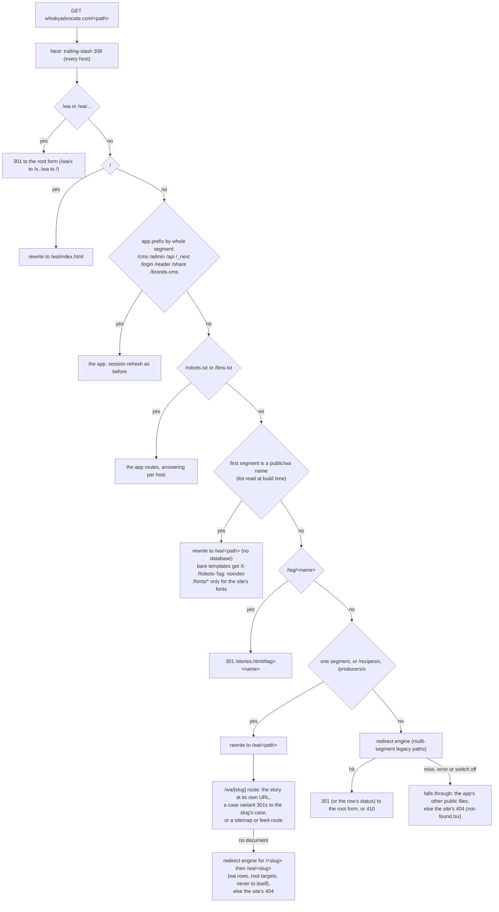
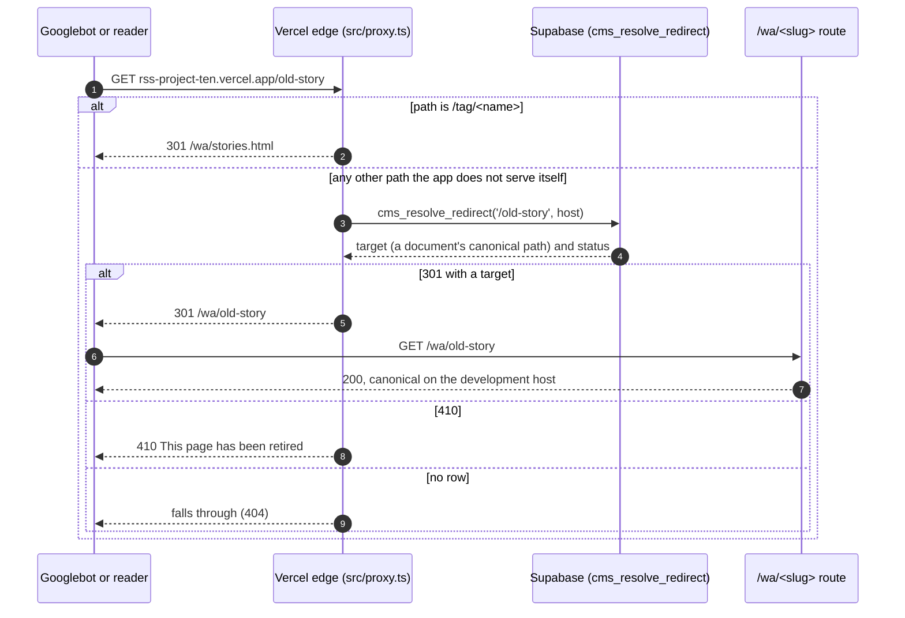

# SEO, redirects and the switch to whiskyadvocate.com

What keeps search rankings when whiskyadvocate.com moves from the old site to this one: the redirect map, canonical URLs, sitemaps, and the checklist for the day the domain moves. Audited on 2026-11-03 against Google Search Console.

## Where things stand

- The new site runs at `rss-project-ten.vercel.app/wa/` (the development host). whiskyadvocate.com is still the old site.
- The development host sends `X-Robots-Tag: noindex, nofollow` (`next.config.ts`, any `*.vercel.app` host). It should never be indexed next to whiskyadvocate.com, because two copies of the same archive split the rankings. A custom domain does not match the rule, so pages become indexable the moment the real domain points here.
- **The root URL shape is built** (2026-11-03). One deployment serves both hosts, and the shape is chosen per request host (`src/lib/wa/site-host.ts`): on a root host (`WA_ROOT_HOSTS`, default `whiskyadvocate.com,www.whiskyadvocate.com`) the site is served at `/`, so `whiskyadvocate.com/<Slug>` stays exactly that URL; on every other host (the development host, previews, localhost) it stays under `/wa` as before.
- Canonical URLs: on a root host `WA_SITE_ORIGIN` when set, else `https://whiskyadvocate.com`, with no prefix; on any other host the request's own origin with `/wa`. `WA_SITE_ORIGIN` never applies to the development host.

## How a request is routed on whiskyadvocate.com

The proxy (`src/proxy.ts`) carries out `decideRoot` in `src/lib/wa/root-routing.ts`, a pure function with a unit-tested table of cases (`src/lib/wa/root-shape.test.ts`, `root-proxy.test.ts`). These rules run before, and outside, the redirect kill switch and the database: a database outage or `REDIRECTS_AT_EDGE=false` never 404s the site.



Every site request the proxy passes on (rewrites and fall-throughs, never the app's prefixes) carries its path in the `x-wa-site-path` request header (`WA_PATH_HEADER` in `root-routing.ts`); `src/app/not-found.tsx` reads it on a root host, so an address nothing answers (a multi-segment miss, a missing file under a site folder) shows the Whisky Advocate 404 instead of the editorial workspace's. The story route's own misses look up the segment exactly as the browser sent it (`request.nextUrl.pathname`), the same key the proxy and the importer use, so a row with a reserved character such as `&` answers on one segment too.

On every other host the proxy behaves as before: `/wa/...` is never touched, paths the old matcher skipped still skip the proxy's work (the matcher is host-conditional: the broad root matcher has a `has` host condition for `whiskyadvocate.com` and its subdomains, the old one a `missing` condition, so the development host's static files never invoke the proxy), and legacy paths 301 to `/wa/<slug>`.

- **A root host must be `whiskyadvocate.com` or one of its subdomains.** Matcher values are build-time constants, and the static pages (`public/wa/site.js`) take the root link shape only on such a host, so `rootHosts()` ignores any other name in `WA_ROOT_HOSTS` (that host keeps the `/wa` shape, which works everywhere). Rehearse on a subdomain such as `staging.whiskyadvocate.com`.

- The redirect engine stores targets in the `/wa` form (`cms_canonical_path`). A root host maps each target through `rootPath` (`/wa/x` to `/x`; an absolute target on a root host, such as `https://www.whiskyadvocate.com/wa/x`, is first reduced to its path), accepts only Whisky Advocate rows, and treats a target equal to the request path (case-insensitive, trailing slash ignored) as no redirect, because the import wrote a row for every story's own old path. The request's query goes before a target's fragment (`/top20.html?utm_source=nl#2019`). The cache is keyed by host and path.
- `/index.html` on a root host serves the home page with `Link: <https://whiskyadvocate.com/>; rel="canonical"`, because every page's logo links to `index.html`.
- `/api/redirects/resolve` answers in the root form only when the request itself is served on a root host; elsewhere (the development host, so everything before the cutover) it returns the rows as stored. The `host` parameter picks the rows (through `REDIRECT_HOST_ALIASES`).
- `next.config.ts` keeps its `/wa` and `/wa/house-ads` redirects for the development host only (a `missing` host condition built from `WA_ROOT_HOSTS` at build time); on a root host `/house-ads` opens `/house-ads/index.html`.
- `robots.txt` on a root host closes the app by whole segment (`Disallow: /reader/` and `/reader$`, never a bare prefix that would block `/reader.js`), keeps `/api/media/` and `/api/wa/` crawlable for the images and the site's data, and names `https://whiskyadvocate.com/sitemap.xml` and `/news-sitemap.xml`.
- A story can be **served by a site page**: when its `metadata.page_file` names a top-level `public/wa` page (the CMS's "Served by site page" field), its URL answers with that page, with the story's head tags (title, description, canonical and `og:url` for the host, robots with the story's `noindex`, the share card and picture, the article JSON-LD). The field takes only a lowercase top-level page name (`documentPatch` refuses anything else). The water tool lives this way at `whiskyadvocate.com/how-to-water-your-whisky` (`water.html`).
- Publishing keeps a migrated story's slug exactly (`20261103170000_cms_publish_keep_slug.sql`), so republishing never changes its URL.

## How an old URL reached its page before the root shape (the development host today)



- The map is the `cms_redirects` table: one row per old path, pointing either at a document (the target follows the document if its slug changes) or at a fixed path. On 2026-11-03 it held 12,516 permanent (301) rows and 356 retired (410) rows, all for `whiskyadvocate.com`.
- Hosts compare without a leading `www.` (migration `20261103161000_cms_redirect_host_www.sql`), so `www.whiskyadvocate.com/<path>` resolves exactly like `whiskyadvocate.com/<path>`.
- The proxy caches each answer for five minutes per server instance and records hits (`hit_count`, `last_hit_at`), so the redirects that matter can be seen after the move.
- A slug changed in the CMS leaves a redirect from the old address behind (`src/app/api/cms/documents/[id]/route.ts`, source `slug_change`).
- `hit_count` counts every lookup that found a row, including a story's own import row looked up while the story is unpublished (answered 404, since a row never redirects to itself) and rows another brand's host discards. Read it as "this old path is asked for", not "this redirect fired".
- `REDIRECT_HOST_ALIASES=staging.whiskyadvocate.com=whiskyadvocate.com` lets a staging host answer with the old domain's redirect rows (`redirectLookupHost` in `site-host.ts`, used by the proxy, the story route's misses and `/api/redirects/resolve` alike); it does not change the URL shape, which follows `WA_ROOT_HOSTS` alone. `REDIRECTS_AT_EDGE=false` turns the redirect lookups off (the root shape keeps serving).

### Testing the root shape locally

Run a production build without database variables and send the root host in the Host header:

```bash
npx next build && npx next start -p 3456
curl -sI -H 'Host: whiskyadvocate.com' http://localhost:3456/            # 200, the home page
curl -sI -H 'Host: whiskyadvocate.com' http://localhost:3456/wa/finder.html  # 301 /finder.html
curl -s  -H 'Host: whiskyadvocate.com' http://localhost:3456/robots.txt
curl -sI http://localhost:3456/wa/stories.html                         # the development shape, unchanged
```

To try it on a deployed staging domain, use a subdomain of whiskyadvocate.com (for example `staging.whiskyadvocate.com`), add it to `WA_ROOT_HOSTS`, and set `REDIRECT_HOST_ALIASES=staging.whiskyadvocate.com=whiskyadvocate.com` so the old addresses answer (never the development host, which must keep `/wa`; a host outside whiskyadvocate.com is ignored).

## Audit against Search Console (2026-11-03)

All 3,111 whiskyadvocate.com pages that had Google clicks from July 18 to October 31, 2026 (95,654 clicks) were checked against the map.

| Result | Pages | Clicks | Share of clicks |
|---|---|---|---|
| 301 to a live page on the new site | 3,078 | 88,641 | 92.7% |
| 410 retired on purpose (`/login`, `/search`, `/Whisky-Clubs-New`) | 5 | 151 | 0.2% |
| No redirect | 28 | 6,862 | 7.2% |

Of the 28 without a redirect:

- **The home page `/`** (6,582 clicks): on a root host `/` now opens the site's home page (the development host still opens the CMS).
- **Tag pages** (`/tag/...`, `/Tag/...`, 20 pages): now handled. They redirect to the story list filtered by that tag.
- **Five stories published on the old site after the last import** (`/how-low-barrel-entry-proof-impacts-whiskey`, `/15-high-scoring-whiskies-55-dollars-and-under`, `/elmer-t-lee-40th-anniversary-bourbon-lottery`, `/sweepstakes`, `/Blockbuster-Macallan-Bottle-Sells-for-2.7-million-Smashing-Previous-Record`): they need the catch-up import below.

Subdomains are separate sites and are not moved by pointing the bare domain here: `top20.whiskyadvocate.com` (14,302 clicks, the single biggest search page), `store.`, `sub.`, `whiskybars.` and `scotch.`. Leave them running where they are, or give each a host redirect (for example `top20.whiskyadvocate.com/` to `https://whiskyadvocate.com/top20.html`) on the day.

## The URL shape decision

Decided and built: the site is served at the root of the production domain, so `whiskyadvocate.com/old-story` stays exactly that URL with no redirect. The routing is above; the page links in `public/wa` are built from `WA.BASE` (`""` at the root, `"/wa"` on the development host, injected by the server as `window.WA_BASE`), and the stored bodies' `/wa/...` links are rewritten at render (`cleanBody`) and by the root `/wa` 301.

## Switch checklist

Before the move:

1. Run a final catch-up import from the old CMS, so every story published there exists here (this closes the five missing stories above), then regenerate the static export (`scripts/wa-export-stories.py`).
2. Apply `20261103170000_cms_publish_keep_slug.sql`, so republishing an imported story keeps its mixed-case address.
3. Leave `WA_SITE_ORIGIN` unset (root hosts default to `https://whiskyadvocate.com`), or set it to the chosen canonical origin; it applies to root hosts only. Check `WA_ROOT_HOSTS` (default `whiskyadvocate.com,www.whiskyadvocate.com`); a change needs a redeploy, because `next.config.ts` reads it at build time.
4. Finish the media rehost and gallery jobs (`cms-maintenance.yml`: rehost, gallery import, bottle images) before DNS moves: once whiskyadvocate.com points here, the legacy media paths those jobs fetch (`/files/...`, `/get/files/...`, `/wp-content/...`) reach the new app and 404.
5. Test the root shape locally with a Host header (above) and a sample of old URLs end to end on a staging subdomain of whiskyadvocate.com listed in `WA_ROOT_HOSTS` and aliased in `REDIRECT_HOST_ALIASES` (the audit query is in this document's history: every Search Console page checked against `cms_redirects`).
6. Plan the subdomains (`top20.`, `store.`, `sub.`).

On the day:

1. Point `whiskyadvocate.com` and `www.whiskyadvocate.com` at the Vercel project (one host redirects to the other; the redirect map answers both).
2. Check that the production domain does not send `noindex` (only `*.vercel.app` does).
3. Set `WA_ROOT_LIVE=1` in production and redeploy: newsletters then link `https://whiskyadvocate.com/<slug>` (until then they link the story's public URL or the development host's `/wa` address, because the old site has none of the new CMS's stories).
4. In Search Console, submit `https://whiskyadvocate.com/sitemap.xml` (it lists the story, rating and page sitemaps) and `https://whiskyadvocate.com/news-sitemap.xml`.
5. Watch the 404 report in Search Console and the `hit_count` on `cms_redirects` for the first two weeks; add rows for any old path that still misses.

After the move, editors publish in the new CMS only; the old CMS is retired, and its import stops.

## Related

- [website.md](website.md): the site's pages and routes.
- [indexing-and-search.md](indexing-and-search.md): sitemaps, feeds and Google News.
- [migration.md](migration.md): how the redirect map was built.
