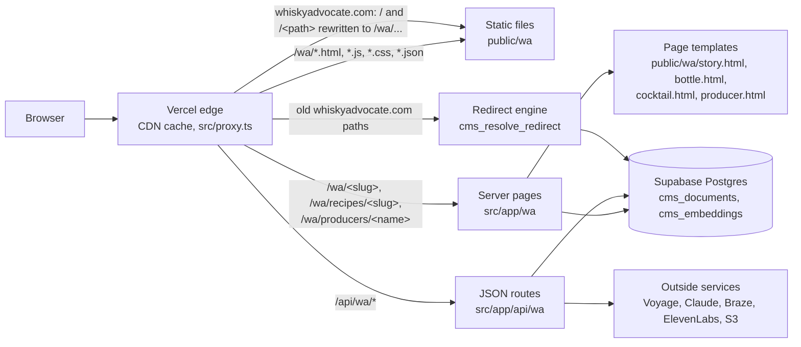
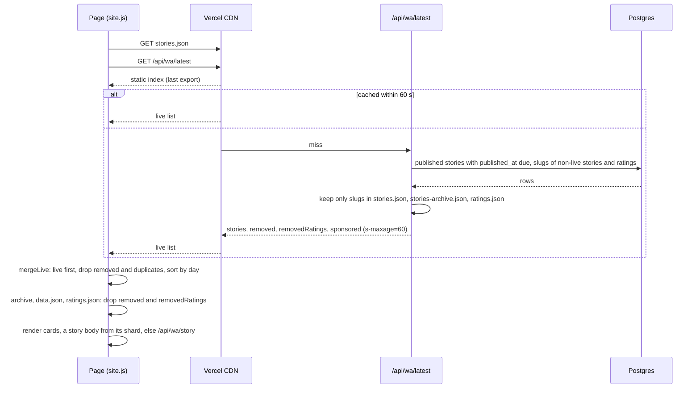

# The public website (`/wa`)

The new Whisky Advocate site lives in the same Next.js app as the CMS. Most of it is static files in `public/wa`: HTML pages, one shared script (`site.js`), one stylesheet (`site.css`) and JSON data files exported from the CMS. Around that static core sit server-rendered pages (one URL per story, rating, recipe and producer) and a set of small JSON routes under `/api/wa` for anything that must be live or needs a model.

Today the site runs on the development host, `https://rss-project-ten.vercel.app/wa`. On whiskyadvocate.com (a root host, `WA_ROOT_HOSTS`) the same deployment serves it at the root: `/`, `/<slug>`, `/stories.html`, `/recipes/<slug>`, with the paths below minus their `/wa` (the routing is in [seo-and-cutover.md](seo-and-cutover.md)). The development host sends `X-Robots-Tag: noindex, nofollow` (set in `next.config.ts` for every `*.vercel.app` host), so it never competes with whiskyadvocate.com in search. The move to the real domain is covered in [seo-and-cutover.md](seo-and-cutover.md).

## How a request is served

- Static files are served straight from the CDN. They change only when a commit lands on `main` and Vercel redeploys.
- Server pages read the database on each cache miss and fill a static template with the item's text, head tags and structured data.
- JSON routes are cached at the edge where the answer is the same for everyone (see the table below), and rate limited where a request costs money.
- Any path the app does not serve itself goes through `src/proxy.ts` to the redirect engine, so old URLs keep working. See [seo-and-cutover.md](seo-and-cutover.md).

## Static pages and shared files

Every page is a plain HTML file in `public/wa` that loads `site.css` and `site.js` (and `ads.js` through `site.js`).

| Page | What it is |
|---|---|
| `index.html` | Home: the split front page, tools, stories, the shelf scan. |
| `stories.html`, `story.html` | Story list (sections, `#tag=`, `#by=` filters) and the hash-routed story reader. |
| `finder.html`, `bottle.html` | Ratings finder with filters and side-by-side comparison; one rating. |
| `shelf.html` | My Shelf: saved bottles, owned and wanted, and your palate. |
| `cocktails.html`, `cocktail.html` | Recipe library with pantry matching; one recipe. |
| `guides.html`, `travel.html`, `video.html` | Channel pages. Guides carries the glossary. |
| `producers.html`, `producer.html` | Every rated house; one producer's portfolio. |
| `top20.html`, `ninety.html` + `ninety.js`, `club.html` | Top 20 of the year; the 90+ Club partner pages (the shelf hero, members, film, stories, spirits). |
| `flavor-map.html`, `globe.html`, `tools.html` | The tools: flavor map, distillery globe, the tools index. |
| `water.html`, `water.js` | Water your whisky: water to add for any rated bottle, the perfect-proof calculator, a lineup at one strength with cost per glass. |
| `whisky-bars.html`, `whisky-bars.js` | America's Top Whisky Bars (formerly whiskybars.whiskyadvocate.com): film hero, SVG map and searchable list of every bar with Near me, the six classic cocktails, the film and sponsors. Data in `whisky-bars.json`, built from the editors' Google Sheet by `node scripts/wa-whisky-bars.mjs`; `?bar=<slug>` (or the old `?bar=<n>`) opens a bar, `?state=<name>` a state. |
| `whisky-bar.html`, `whisky-bar.js` | Template for a page per bar and per state at `/whisky-bars/<slug>` (`/wa/whisky-bars/<slug>` on the development host), rendered by `src/lib/wa/bars.ts` (`src/app/wa/whisky-bars/[slug]/route.ts`): the bar or state beside a dark map of the state with city labels, more bars in the state, nearby bars, every state; `BarOrPub` / `CollectionPage` and breadcrumb structured data; all listed in `sitemap-pages.xml`. |
| `industry.html`, `retailers.html`, `retailer-club.html` | Trade pages: sell sheets, retailer listings. |
| `newsletter.html`, `search.html`, `app.html`, `about.html`, `contact.html`, `privacy.html` | Sign-up, site search, the WhiskyFest app link, company pages. |

Shared scripts:

| File | What it does |
|---|---|
| `site.js` | Everything shared: data loading (`WA.stories`, `WA.storiesAll`, `WA.archive`, `WA.loadJSON`), story and bottle cards, the menu, site search overlay (slash or Cmd+K), the Ask chat, sponsored labels, newsletter forms, recommendations, measurement hooks (GA4 when a page carries `<meta name="ga4">`), sticky filters, video players, the ambient WebGL field. |
| `site.css` | The design. Per `AGENTS.md`, new rules are appended in their own commented blocks. |
| `catalog-core.js` | Pure catalogue rules (no network, no DOM): name normalising, query understanding, fuzzy name scores, pantry and recipe matching (`WACatalog`). Tested in `src/lib/wa/catalog.test.ts`. |
| `reader-core.js` | Reader state in `localStorage` under `wa.reader.v1`: shelf, pantry, preferences, import of a shelf. Tested in `src/lib/wa/reader.test.ts`. |
| `reader.js` | Reader tools on top of it: saves, dialogs, keyboard behaviour, preferences. |
| `discovery.js` | The search page: word matches across bottles, stories, recipes and producers, then meaning matches and the answer panel from the API. |
| `editorial.js` | Buying-guide cards near the end of a story, rating, recipe or the home page, picked by meaning, loaded when the section nears the screen. Not shown on sponsored pages. |
| `palate.js`, `glass.js`, `in-the-glass.js`, `flavor-map.js`, `globe.js`, `sell-sheet.js` | Palate profile from My Shelf, the WebGL glass for ratings without a photo, the rating page's flavor band, the flavor map, the globe, and PDF sell sheets. |
| `ads.js` | Google Ad Manager tags. See [ads.md](ads.md). |

### The data files

The pages read JSON files that sit beside them. They are regenerated by scripts from the CMS or the old site, never hand edited, and per `AGENTS.md` always regenerated from the current export rather than restored from an older copy.

| File | Contents | Written by |
|---|---|---|
| `stories.json`, `stories-archive.json` | The story index (last twenty months; the rest back to 2016), one entry per story: id, title, slug, byline, day, section, tags, lead picture, dek, minutes, sponsored flag | `scripts/wa-export-stories.py` |
| `articles/00.json` to `63.json` | Story bodies, sharded by a hash of the slug | `scripts/wa-export-stories.py` |
| `sponsored.json` | Slugs of paid stories, with the sponsor when known | `scripts/wa-export-stories.py` |
| `ratings.json`, `notes/00.json` to `63.json` | Every published rating as columns and rows (`slug, n, c, s, p, a, pr, by, issue, d, sm, sw, ri, li, img, w`), and the tasting notes sharded by slug | A CMS ratings export (no script in the repo writes it today; see below) |
| `flavor.json` | Flavor profiles with map positions | `scripts/wa-export-flavor.ts` (profiles from `scripts/wa-flavor-profiles.ts`) |
| `globe.json` | Where each producer with three or more ratings makes its whisky | `scripts/wa-producer-places.ts` |
| `ninety.json` | The 90+ Club page | `scripts/wa-ninety.py` |
| `cocktails.json`, `top20.json`, `top20-films.json`, `videos.json`, `glossary.json`, `retailers.json`, `shop.json`, `store.json`, `data.json` | Recipes, Top 20, films, glossary, retailers, store matches | Built from the old site and kept current by `scripts/wa-rehost-static.ts` (images), `scripts/wa-rewrite-legacy-links.ts` (links) and `scripts/wa-video-posters.py` (posters) |

The export script dates stories from the old site's fields (`metadata.legacy_dates`). Stories published from the CMS are covered by the live merge below, so the export does not need to run after every publish.

Watch out: `ratings.json` has no generator in `scripts/`. It was produced by earlier one-off exports; if ratings change in the CMS, regenerate it the same way and check the column list above still matches `site.js` (`archive()`).

## Stories published from the CMS: the live merge

The static index only knows what the last export saw. So that a story is on the home page, in the lists, in search and in ad targeting within about a minute of publishing, the site merges a live list over it.

- `GET /api/wa/latest` (`src/app/api/wa/latest/route.ts`, built by `src/lib/wa/live-stories.ts`) returns:
  - `stories`: every story with `published_at` set and due (the CMS publish step stamps it), newest first, up to 300, in the same shape as `stories.json`. Section and dek follow the export script's rules, with the editor's section winning.
  - `removed`: story slugs that `stories.json` or `stories-archive.json` still list whose documents (kinds `article` and `legacy_record`) are no longer live, so the pages stop showing them.
  - `removedRatings`: the same for ratings: slugs `ratings.json` still lists whose `rating` documents are no longer live.
  - `sponsored`: the paid stories among them, for `ads.js`.
- **The takedown rule** (`takenDownOf` in `src/lib/wa/live-stories.ts`): the two lists are public (CORS `*`), so they only ever name slugs the public static files already show. The route reads the slug column of every non-live document of those kinds (any state but published and due: unpublished, draft, review, archived, or published with a time still ahead), all of them, 1,000 rows a request in id order (PostgREST caps each response at 1,000, and review ratings from print intake run to thousands), keeps only the slugs in the static files (`publicIndex`: the three files read from disk once per instance, traced into the route's bundle by `outputFileTracingIncludes` in `next.config.ts`), and drops any slug a live document of the same kinds still carries. A draft or review item that was never published is in no static file, so its slug (usually its headline) never reaches the list. There is no time window: a story moved back to review a year after the export is still taken off. If the static files cannot be read, both lists are empty (logged) and the live stories still go out.
- `site.js` fetches it once per page (`live()`). `mergeLive` puts the live entries first, drops removed slugs and duplicates, and sorts by day; the archive (`stories-archive.json`, loaded for `{ all: true }`) loses the removed slugs and the live entries' slugs too (`dropTaken`), so the header search, `storyBySlug`, related lists and every archive page agree. A removed story is therefore not found by `story.html`, which asks `/api/wa/story` (live documents only) and shows its not-found message instead of the exported body. `data.json` and `ratings.json` lose `removedRatings` (`ratingsGone`, `dropRatings`): `WA.archive` waits for the list before it hands the ratings over, and so does `WA.ready` when the page's callback takes the data (`cb.length`; the pages that render ratings from it). The page's chrome (entrance, ask bar, header) and a callback that takes nothing start as soon as `data.json` is in, and `WA.data()` drops the removed ratings when the list arrives, before any later lookup or ask-bar answer. So the finder, the flavor map, bottle search and the rest never show a rating taken down after the export. `discovery.js` applies all three lists on the search page.
- A story's body comes from its article shard, else from `/api/wa/story` (`liveBody`).
- If the route fails or times out (8 s), the page uses the static files alone, as before the lists existed: nothing is dropped. The ratings wait is capped at 1.5 s (`RATINGS_WAIT_MS`) and only the pages that render ratings take it, so a slow route never holds a page long; past that the page renders every rating, and `WA.data()` still loses the removed ones once the list arrives. Old pages that do not know `removedRatings` ignore it.

## Server-rendered pages

| Route | Template | What it adds |
|---|---|---|
| `/wa/<slug>` (`src/app/wa/[slug]/route.ts`) | `story.html` for stories and pages, `bottle.html` for ratings | Reads the published document (`loadDoc` in `src/lib/wa/seo.ts`), skipping scheduled ones. Product reviews redirect to `club.html`, glossary entries to the glossary. A differently capitalised slug 301s to the canonical one. Cached `s-maxage=120, stale-while-revalidate=86400`. |
| `/wa/recipes/<slug>` | `cocktail.html` | Built from `cocktails.json` (`recipePage` in `src/lib/wa/exported-content.ts`). Cached 10 minutes. |
| `/wa/producers/<name>` | `producer.html` | Built from `ratings.json` (`producerPage`), without the ratings taken down since the export (`removedRatingSlugs` in `live-stories.ts`, the same rule as `removedRatings`, kept a minute per instance; none where delivery does not read the CMS). Cached 10 minutes; a minute when the takedowns could not be read. |

`src/lib/wa/seo.ts` writes the head of each page:

- Title, meta description (158 characters), canonical URL, Open Graph and Twitter tags, and `robots` (`noindex, follow` for documents marked no-index).
- JSON-LD: `NewsArticle` or `Article` (or `AdvertiserContentArticle` with a `sponsor` when paid) with authors, dates, publisher and the entities a story is about; a `BreadcrumbList`; `Review` with a 0 to 100 `Rating` for bottles.
- The site's shape comes from the request host (`siteFor` in `src/lib/wa/site-host.ts`): on a root host the origin is `WA_SITE_ORIGIN` when set, else `https://whiskyadvocate.com`, and paths have no prefix; on any other host the request's own origin and `/wa`. Every builder takes that `{ origin, base }`, and the page gets `window.WA_BASE` for `site.js`.
- A story whose `metadata.page_file` names a top-level `public/wa` page ("Served by site page" in the CMS) is answered with that page at the story's URL, its canonical and `og:url` set to that URL (`sitePage`). The water tool (`water.html`) is served this way at `/how-to-water-your-whisky`.

On preview deployments (no database delivery, `deliveryEnabled()` false) `/wa/<slug>` falls back to the exported files (`exportedPage`), so previews still show content.

Why server pages: the static `story.html#slug` reader cannot carry per-story head tags, so search engines would see one page. A real URL per story with its own title, description, canonical and structured data is what keeps search traffic. `site.js` links to `WA.BASE + "/<slug>"` on the live hosts (`/<slug>` on whiskyadvocate.com, `/wa/<slug>` on the development host) and keeps the hash pages for the artifact copy (`WA.BASE` null). Page links in `public/wa` use `WA.BASE`, never a literal `"/wa/"`; `/api/wa/...` fetches stay as they are on both hosts.

## The `/api/wa` routes

| Route | Does | Cache | Limit |
|---|---|---|---|
| `GET /api/wa/front` | The home rotator's five positions: pins from `/cms/front`, the newest stories elsewhere (`resolveFront`). Merges CMS-dated and imported stories by date. A pin whose story is not live (scheduled, or taken down) gives its position to the newest story, like an ended pin. | `s-maxage=60, swr=300` | none |
| `GET /api/wa/latest` | Stories published from the CMS since the export, removed story and rating slugs (only ones the static files list), sponsored list (above). | `s-maxage=60, swr=300` | none |
| `GET /api/wa/story?slug=` | One published story's index entry and body, for stories not in the export. | `s-maxage=300, swr=3600` | none |
| `GET /api/wa/meaning?q=` | Stories and ratings close in meaning to the query (no model call). See [indexing-and-search.md](indexing-and-search.md). | `s-maxage=86400, swr=604800` | 40 a minute per visitor (shared) |
| `GET /api/wa/answer?q=` | The search page's written answer from matched ratings and stories (Claude). | `s-maxage=3600, swr=3600` (short, so a cached answer does not keep citing a story or rating taken down) | 20 a minute per visitor, and `WA_ANSWER_HOURLY` (default 600) written answers an hour site-wide |
| `POST /api/wa/ask` | The Ask chat on every page: Claude answers from the bottles the page's own search found plus meaning matches. Nothing stored. Model `WA_ASK_MODEL`. | none | 12 a minute per address (per instance) |
| `POST /api/wa/recommend` | Bottle picks for a story, cocktail, bottle or producer page, with a line of why. Cached by content and candidates in the `wa_recommendations` table, so a page costs one model call until it changes. Model `WA_RECOMMEND_MODEL`. | `s-maxage=600` on a stored hit | none |
| `GET /api/wa/similar?slug=` | Stories like this one by embedding (`wa_match_documents`), live stories only. Empty until embedded, and for a story not live yet. | `s-maxage=300` when empty | none |
| `GET /api/wa/bottles-like?slug=` | Ratings closest by note, re-ranked by flavor profile and spread across houses (`rankSimilar`). | `s-maxage=3600, swr=86400` | none |
| `POST /api/wa/shelf-scan` | A photo of a shelf: Claude reads the labels, each is matched to a published rating. Nothing stored. | `no-store` | 12 a minute per address (per instance) |
| `POST /api/wa/newsletter` | Sign-up: writes the profile and subscription groups to Braze (`BRAZE_REST_ENDPOINT`, `BRAZE_REST_API_KEY`). | none | 10 a minute per address (per instance) |
| `POST /api/wa/tts` | A story read aloud, one paragraph at a time, by ElevenLabs (`ELEVENLABS_API_KEY`, `WA_TTS_VOICE`, `WA_TTS_MODEL`); each paragraph is recorded once into S3 (`S3_BUCKET`). Without a key it answers 503 and the page uses the browser's voice. | `max-age=86400` on recorded audio | 60 a minute per address (per instance) |
| `GET /api/wa/bottle/<slug>` | The standard bottle shot: a 302 to a signed S3 link, or 404 when there is none. | `s-maxage=86400` | none |
| `GET /api/wa/cleared/<id>` | A bottle photo with its background lifted (`scripts/clear-backgrounds.ts`), as a signed S3 link. | `s-maxage=86400` | none |
| `GET /api/wa/asset/<file>` | A legacy image re-hosted for the static data files (`cms/legacy/wa/<sha256>.<ext>`), resized with `?w=` and converted with `?format=`; PDFs as stored; videos as a signed S3 redirect. | `s-maxage=31536000, immutable` | none |

### Rate limits

Two kinds:

- **Shared counter** for the search routes (`meaning`, `answer`): `withinLimit` in `src/lib/wa/rate-limit.ts` calls `wa_rate_hit(bucket, limit, window)` (migration `20261103120000_wa_rate_limits.sql`), a fixed-window counter in the `wa_rate_limits` table that every server instance shares. The visitor key is a SHA-256 hash of the IP, never the address itself. It fails open: if the database cannot answer, the request goes through. Cached responses never reach the counter. Old windows are swept on about 1 in 100 hits.
- **In-memory counters** in `ask`, `shelf-scan`, `newsletter` and `tts`: a per-instance map per IP for one minute. Cheap, but each server instance counts on its own, so the effective limit grows with instances. Move a route to `withinLimit` if it starts being abused.

Why: the meaning and answer routes cost a Voyage call and sometimes a Claude call per uncached query, and bots hit search. A shared counter in Postgres needs no new service.

## The home page

`index.html` opens with the split front page (`section.front-split`):

- `.split-news` (`#front`) is the news rotator: five stories from `/api/wa/front`, merged with the story index for pictures. Editors pin positions at `/cms/front`.
- `aside.split-ask` holds the Ask form and the tool rows (finder, flavor map, globe and others).
- Below: the billboard ad, tools, the story bands built from the index (lead, side and thirds by section), and the shelf scan, which posts a photo to `/api/wa/shelf-scan` and shows the matched ratings.

Why split: news comes first without pushing the tools below the fold.

## Reader features

- **My Shelf** (`shelf.html`, `reader-core.js`, `reader.js`): bottles saved as owned or wanted, a pantry for cocktails, preferences. Stored only in the browser (`wa.reader.v1`); nothing is sent to a server. `palate.js` works out a flavor profile from the shelf.
- **Finder** (`finder.html`): filters, sort, and comparison of chosen bottles, with `WACatalog` rules.
- **Cocktails**: pantry modes match recipes to what you have (`WACatalog.pantry`, `missingIngredients`).
- **Search** (`search.html`, `discovery.js`): word matches first, then meaning matches and an answer from the API.
- **Flavor map, globe, rating flavor band**: WebGL drawings over `flavor.json` and `globe.json`.
- **Sell sheets** (`industry.html#sheet=<slug>` or `#portfolio=<name>`): a rating or a producer's portfolio as a PDF, for the trade.
- **Top 20, 90+ Club**: data pages from `top20.json` and `ninety.json`; the 90+ Club is Pernod Ricard USA's partner page and is marked sponsored for ads.

## Newsletter sign-up

Every `form.nl-strip` and the newsletter page post `{ email, lists, source }` to `/api/wa/newsletter` (`WA.signup`). The route writes the profile with Braze `/users/track` and sets each chosen subscription group with `/subscription/status/set`. The lists are WhiskyNotes, Cocktail Club, Whisky Weekend and Offers and Promotions; the group ids are the ones the live winespectator.com sign-up page uses, so a reader lands in the same Braze channels either way. If the route fails, the form links to the old sign-up page.

## Changing the site

- Read `AGENTS.md` first. Claude Code and Cursor both commit to `main` under `public/wa`. Fetch `main` and edit its version of each file; never copy a folder or stylesheet over `public/wa`; append CSS in its own commented block; check the diff for removed lines with `git diff origin/main... -- public/wa/site.css | grep '^-'`; keep commits small. `public/wa/gen` is scratch and is not committed.
- Static changes go live when the commit reaches `main`. Server routes and the API change the same way.
- To test locally, serve `public` (`python3 -m http.server 8765`) and route `/api/**` to the live host; the static pages work without the database.
- Data files: regenerate with their script from the current CMS export. Never restore an older copy.
- Never run two `cms-maintenance.yml` jobs at once; four at once exhausted the database connection pool.

## Watch out for

- Relative URLs in pages resolve against the page path. On clean URLs (`/wa/<slug>`, or `/<slug>` at the root) that is the site's folder, but on `/recipes/<slug>` it is one level down, so the recipe and producer pages carry `<base href="${base}/">`; shared scripts resolve their sibling files from their own script URL (see `SCRIPT_SRC` in `ads.js`).
- Story pages are cached two minutes at the edge with a day of stale-while-revalidate, so a correction shows on the next request after two minutes.
- `/wa/house-ads` would reach the story route; `next.config.ts` redirects it to `/wa/house-ads/index.html` (on a root host the proxy sends `/house-ads` there instead).
- The live merge covers stories with `published_at`. Imported stories edited in the CMS keep their exported list entry (title, dek, picture) until the export runs again; their pages are live.
